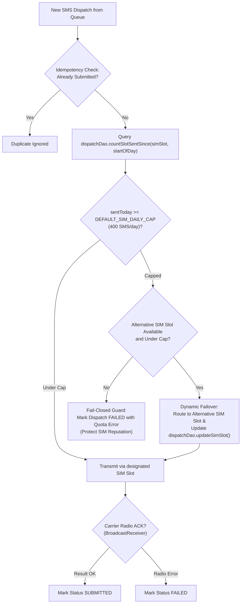

# BriskSMS Android Companion Architecture & Cellular Relay Topology

**Document:** `docs/architecture/ANDROID_COMPANION_AND_RELAY_TOPOLOGY.md`  
**Classification:** Core System Architecture & Edge Node Operations  
**Audience:** Platform Architects, Mobile Engineers, and Fleet Operators  

---

## 1. High-Level Role & Boundaries

The **BriskSMS Android Companion Application** (`apps/android`) is a purpose-limited hardware companion and cellular relay node. It operates on physical Android hardware located in Tanzania, bridging cellular operator infrastructure with the BriskSMS backend.

### Architectural Invariants:
* **Observational Only (Product A):** The companion app intercepts and forwards incoming payment notifications. It possesses **zero autonomous settlement authority**; all financial balance mutations occur on the cloud backend inside PostgreSQL ACID transactions.
* **Passive Carrier Relay (Product B):** Outbound cellular dispatches are executed via Android `SmsManager`. Prepaid credit balances and quotas are managed strictly on the backend.
* **Play Store Privacy Compliance:** The application **never requests `READ_SMS` or `RECEIVE_SMS` permissions**. Financial notifications are collected exclusively via the sanctioned Android `NotificationListenerService`. Personal messages, WhatsApp, and social communications are strictly discarded at the OS boundary.

---

## 2. Ingestion Topology: Dual-Channel Architecture

During peak commercial hours (e.g., Friday evenings, month-end salary dates), mobile network operators in Tanzania experience Short Message Service Center (SMSC) buffer delays. While the payer receives an instant debit confirmation, the merchant's gateway SIM may experience carrier latency ranging from 30 seconds to several minutes.

To minimize latency, BriskSMS employs a **Dual-Channel Ingestion Architecture**:

```mermaid
flowchart TD
    subgraph Payer Handset
        Payer["Customer Wallet Handset"]
    end

    subgraph Telco Infrastructure [Vodacom / Tigo / Airtel]
        Core["Telco Core Network"]
        SMSC["Carrier SMSC Gateway (GSM Cellular)"]
        PushServer["Carrier App Notification Server (FCM / APNs)"]
    end

    subgraph Companion Android Device [BriskSMS Companion Node]
        GSMModem["GSM Radio Baseband"]
        ProviderApp["M-Pesa / Mixx Official App"]
        Listener["BriskNotificationListenerService<br/>(Play Store Sanctioned)"]
        Filter["PaymentProviderRegistry + EvidenceEncryptor<br/>(Source Whitelist + AES-256-GCM)"]
        Storage[("Room SQLite Encrypted DB<br/>(AES-256-GCM)")]
        Worker["WorkManager Forwarding Engine"]
    end

    subgraph BriskSMS Cloud
        API["API Monolith (:3000)"]
        Ledger[("PostgreSQL Ledger")]
    end

    Payer -->|*150*00# Payment| Core
    Core -->|Standard Cellular SMS| SMSC
    Core -->|Instant App Push| PushServer

    SMSC -.->|Congestion Latency (30s-3m)| GSMModem
    PushServer -->|Instant IP Push (<5s)| ProviderApp

    GSMModem -->|Status Bar SMS Notification| Listener
    ProviderApp -->|Status Bar App Notification| Listener

    Listener --> Parser
    Parser --> Storage
    Storage --> Worker
    Worker -->|TLS 1.3 + Keystore ECDSA Signature| API
    API --> Ledger
```

### Why Dual-Channel Ingestion Slashes Latency:
* **GSM SMS:** Dependent on carrier tower paging channels and congested SMSC queues.
* **Official Provider App Notifications:** Transmitted over IP networks (Wi-Fi or Mobile Data via Firebase Cloud Messaging). These notifications frequently arrive **15 to 45 seconds ahead of the carrier SMS**, enabling sub-10-second payment confirmation even during cellular network congestion.

---

## 3. Cellular Messaging Engine: Daily Limits & Smart SIM Failover

Tanzanian mobile operators enforce Fair Usage Policies (FUP) and anti-spam monitoring on standard SIM lines. Blasting high volumes of SMS over a single consumer SIM card leads to carrier line suspension.

To protect merchant SIM cards, BriskSMS implements **Automated Quota Monitoring & Smart SIM Failover**:



### Key Parameters:
* `DEFAULT_SIM_DAILY_CAP = 400`: Maximum outbound messages per calendar day per SIM slot.
* `DEFAULT_DISPATCH_PACING_MS = 1500L`: Mandatory 1.5-second pacing delay between consecutive dispatches to prevent anti-spam trigger alarms at the base transceiver station (BTS).

---

## 4. Device Management System: Durable Telemetry Command Bus

Rather than maintaining fragile persistent WebSocket connections across fluctuating cellular connections, BriskSMS utilizes a **PostgreSQL-Backed Asynchronous Telemetry Command Bus** (`device_commands`, migration `20261115000000_durable_device_commands`):

```
[Merchant Console] ──► POST /v1/devices/:id/command ──► [PostgreSQL: device_commands]
                                                               │
                            Piggybacked in                     │ Atomic FOR UPDATE SKIP LOCKED
                            Telemetry Response (DELIVERED)     ▼
[Android Companion] ◄── POST /v1/devices/:id/telemetry ────────┘
  (TelemetryWorker)  ──► POST /v1/devices/:id/commands/:commandId/ack (or inline commandAcknowledgements)
```

### Supported Remote Fleet Commands:

Only the 4 end-to-end implemented command types are permitted (`PAUSE_RELAY`, `RESUME_RELAY`, `SWITCH_SIM`, `WIPE_AND_REVOKE`); undocumented commands (`PING`, `SYNC`, `RESTART_SERVICE`, etc.) fail closed with HTTP `400 INVALID_COMMAND`:

| Command | Payload Contract | Action on Android Handset | Security & Retry Semantics |
|---|---|---|---|
| `PAUSE_RELAY` | `{}` (empty/omitted) | Halts `SmsGateRelayService` loop and sets `isBulkMessagingEnabled = false`. | At-least-once lease delivery (`maxDeliveryAttempts = 5`). |
| `RESUME_RELAY` | `{}` (empty/omitted) | Restarts foreground service and resumes queue processing. | At-least-once lease delivery (`maxDeliveryAttempts = 5`). |
| `SWITCH_SIM` | `{ "simSlot": 1 \| 2 }` | Validates `simSlot in 1..2` and sets `preferredSimSlot` in `KeystoreSecureStorage` (invalid slots fail closed with `FAILED` ACK). | At-least-once lease delivery (`maxDeliveryAttempts = 5`). |
| `WIPE_AND_REVOKE` | Optional `{ "reason": "..." }` | Wipes local SQLite database, revokes device tokens, and deletes Android Keystore ECDSA private key; `403 DEVICE_REVOKED` interceptor also wipes credentials immediately. | Atomically cancels prior open commands & revokes device server-side (`REVOKED`), `maxDeliveryAttempts = 1` (zero automatic destructive retries). |

### Lifecycle, Leasing, Idempotency & Authorization Invariants:
- **States:** `PENDING` -> `DELIVERED` (leased via `leaseToken` & `leaseExpiresAt`, default `60s`) -> `ACKNOWLEDGED` | `FAILED` | `EXPIRED` | `CANCELLED`.
- **Safe Multi-Replica Claiming:** `POST /v1/devices/:id/telemetry` acquires locks in strict monotonic order (`devices` `FOR UPDATE` -> `device_commands` `FOR UPDATE SKIP LOCKED`) so concurrent polls across multiple API replicas never claim the same active command twice, while expired leases safely allow redelivery (until `expiresAt` or `maxDeliveryAttempts` exhaustion -> `FAILED`).
- **Distinction Between Delivery and Execution:** Returning a command in `POST /v1/devices/:id/telemetry` only moves it to `DELIVERED`. Terminal completion requires explicit device acknowledgement via `POST /v1/devices/:id/commands/:commandId/ack` (with fallback `commandAcknowledgements` retry on next telemetry poll). Duplicate matching ACKs are idempotent (`idempotentReplay: true`); contradictory ACKs (`409 COMMAND_TERMINAL_CONFLICT`), undelivered ACKs (`409 COMMAND_NOT_DELIVERED`), stale leases (`409 STALE_COMMAND_LEASE`), cancelled (`409 COMMAND_CANCELLED`), and expired (`409 COMMAND_EXPIRED`) cannot reverse state.
- **Queue Idempotency & RBAC:** `POST /v1/devices/:id/command` and `POST /v1/devices/:id/commands/:commandId/cancel` require Org `OWNER`/`ADMIN` membership and enforce `(organization_id, idempotency_key)` uniqueness with SHA-256 request fingerprinting (`409 IDEMPOTENCY_KEY_REUSE_CONFLICT` on parameter mismatch). Historical rows are preserved durably in PostgreSQL.
- **Model B Outbound SMSGate Job Acquisition (`outbound_sms_jobs`):** Implemented via migration `20261116000000_android_outbound_sms_jobs` and `OutboundSmsJobService`:
  - Companion devices claim leased jobs via `POST /v1/messaging/device-jobs/acquire` (`devices FOR UPDATE` -> `outbound_sms_jobs FOR UPDATE SKIP LOCKED`) filtered by active ready SIM slots (`1`/`2`).
  - Before invoking Android `SmsManager`, `SmsGateRelayService` commits dispatch intent via `POST /v1/messaging/device-jobs/:jobId/dispatching` (`CLAIMED` -> `DISPATCHING`) and checks `OutboundSmsJobCoordinator.canInvokeSmsManager()`.
  - `ACTION_SMS_SENT` reports `SUBMITTED` or `FAILED` via `POST /v1/messaging/device-jobs/:jobId/result`; `ACTION_SMS_DELIVERED` separately reports `DELIVERED`. Pending result reports survive process death in Keystore AES-256-GCM storage (`PendingSmsJobResultStore`) and flush automatically in `SmsGateRelayService` and `TelemetryWorker`.
  - Expired `DISPATCHING` leases transition fail-closed to `UNCERTAIN` (never auto-requeued or refunded) via both worker sweep (`expireDispatchLeases`) and inline acquire sweeps, while pre-radio failures/expirations/cancellations issue exactly one credit refund.
- **History Retention:** `MaintenanceRunner` calls `purgeOldRelayHistory` every cycle. It deletes only finished rows (`outbound_sms_jobs` DELIVERED, FAILED, EXPIRED, CANCELLED; `device_commands` ACKNOWLEDGED, FAILED, EXPIRED, CANCELLED) whose `updated_at` is older than `HISTORY_RETENTION_DAYS` (default 90, never less than 30). Unfinished rows and `UNCERTAIN` jobs, which need a human decision, are never touched, and `sms_messages`, the credit ledger and the audit log are left alone. It is built not to disturb live traffic: rows are found through the partial indexes `outbound_sms_jobs_history_cleanup_idx` and `device_commands_history_cleanup_idx`, each batch (500 rows) is its own short transaction with `lock_timeout` 2s and `statement_timeout` 15s that uses `FOR UPDATE SKIP LOCKED`, there is a 250ms pause between batches, and one run stops after 20 batches per table so the next hourly run continues. Deleting a job also frees its idempotency key; replays of the same key after the retention period are guarded by `message_idempotency_records`, which is kept.

---

## 5. Physical Companion Deployment SLA & Best Practices

To guarantee 99.9% ingestion reliability and sub-10-second processing:

1. **Cellular Signal SLA:** The companion handset should be placed in an area with a signal strength above `-95 dBm` (minimum 3 bars of 4G/LTE). Poor signal (< `-105 dBm`) causes the baseband processor to retry tower registrations, delaying SMS receipt.
2. **Dedicated AC Power:** Devices should remain plugged into continuous power with the OEM's "Battery Optimization" exemption enabled.
3. **Dedicated Wi-Fi:** Although cellular data works, operating on a stable Wi-Fi connection ensures that outbound evidence forwarding is never interrupted by cellular voice calls or USSD sessions.
4. **Active Telco App Sessions:** Merchants should ensure official mobile money applications (e.g. M-Pesa App) are logged in to maintain active push notification channels.
