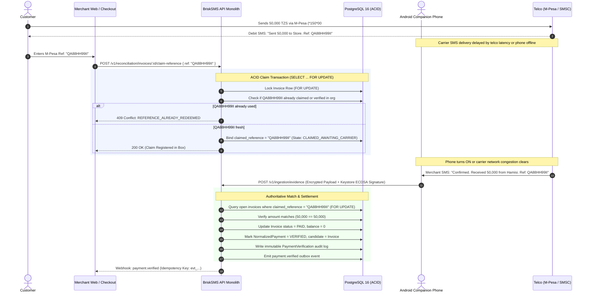

# BriskSMS Financial State Machine & Ledger Integrity Specification

**Document:** `docs/financial/STATE_MACHINE_AND_LEDGER_DESIGN.md`  
**Classification:** Critical Financial Integrity & Audit Governance  
**Audience:** Core Platform Engineers, Financial Auditors, and Payment Operations  

---

## 1. Executive Summary & Non-Negotiable Invariants

BriskSMS is a commercial non-custodial financial reconciliation and cellular messaging SaaS platform. Under **AGENTS.md**, the platform adheres strictly to the following primary invariants:

1. **Non-Custodial Guarantee:** BriskSMS never holds merchant or customer funds, operates an escrow, or acts as a payment clearing house. All funds move directly from the payer's mobile wallet / bank account to the merchant's business account (Vodacom Lipa Kwa M-Pesa, Tigo Pesa, Airtel Money, HaloPesa, CRDB, NMB).
2. **Zero Automated Guesswork:** Automated reconciliation requires strictly deterministic rule matching. Uncertain, ambiguous, or multi-candidate matches must transition to `REVIEW_REQUIRED` (human review). Software scripts or AI must never make authoritative financial settlement decisions.
3. **Raw Evidence Immutability:** Incoming notifications from companion devices are written append-only to `raw_payment_evidence`. Raw evidence records are never updated, overwritten, or deleted.
4. **Deterministic Single-Use Deduplication:** Every payment transaction reference is cryptographically hashed:
   $$\text{Hash} = \text{SHA-256}(\text{org\_id} \parallel \text{provider} \parallel \text{reference} \parallel \text{amount\_cents} \parallel \text{timestamp})$$
   A duplicate payload from a companion device or replayed webhook can never trigger double-settlement or duplicate downstream fulfillment.

---

> [!NOTE]
> **P0.2 Supersession Note (2026-11-16):** The "Unique Transaction Claim Box" diagram below illustrates the initial pre-P0.2 conceptual flow (`claim-reference` was not exposed as an HTTP route). The live implementation enforces global reference claims atomically across **all three** ingestion paths (Companion SMS `/v1/ingestion/evidence`, Manual Reconciliation `/v1/reconciliation/verify`, and STK Callbacks `/v1/payments/stk-push/callback/:provider`) via `PaymentReferenceClaimService` (`payment_reference_claims`, `payment_reference_claim_events`, and `payment_reference_claim_collisions`).

## 2. The Unique Transaction "Claim Box" Concept (Superseded by P0.2 Global Claim Boundary)

When an external customer initiates payment, there is often a time delta between when the payer executes the mobile money transaction and when the merchant's companion device receives and uploads the carrier notification.

To eliminate race conditions, double-spending, and conflicts, BriskSMS employs the **Unique Transaction Claim Box Pattern**:



### Invariant Rules of the Claim Box

1. **Strictly Single-Use Across Organization:**
   A transaction reference (e.g., `QA88HH99II`) can only ever occupy **one** invoice box within an organization. If another user attempts to enter the same transaction ID on a different invoice, the system rejects it immediately with `409 REFERENCE_ALREADY_REDEEMED`.
2. **Amount Consistency Enforcement:**
   Pre-claiming a reference does not bypass financial validation. When the carrier SMS arrives, the parsed `amount_cents` must equal the open invoice balance. If the customer claimed a 50,000 TZS invoice but the carrier SMS proves they only sent 5,000 TZS, the box is routed directly to `REVIEW_REQUIRED` (underpayment discrepancy) without auto-settlement.
3. **No Double-Settlement on Late Arrival:**
   If the merchant provisionally approved an order before the phone turned on, the invoice balance is already 0. When the phone eventually syncs the delayed SMS, the query `SELECT ... WHERE status IN ('UNPAID', 'PARTIALLY_PAID') FOR UPDATE` returns zero rows. The payment notification transitions to `REVIEW_REQUIRED` with the audit reason: *"Invoice already cleared prior to evidence receipt."* The accountant clicks "Bind & Audit" to attach the official receipt without altering financial balances.

---

## 3. Formal Multi-Tier Reconciliation State Machine

Every payment ingested into BriskSMS transitions through a deterministic state machine:

```
                            [Companion Notification Uploaded]
                                           |
                                           v
                                    +--------------+
                                    |   OBSERVED   | (Append-only raw evidence)
                                    +--------------+
                                           |
                                           v
                                    +--------------+
                                    |  NORMALIZED  | (Parsed provider, amount, phone, ref)
                                    +--------------+
                                           |
                      +--------------------+--------------------+
                      |                                         |
     (Tier 1: Exact Reference Match)          (No Reference in Memo)
                      |                                         |
                      v                                         v
               +--------------+                         +----------------+
               |   MATCHED    |                         | Phone Matches  |
               +--------------+                         | Open Invoices? |
                      |                                 +----------------+
                      |                                         |
                      |                          +--------------+--------------+
                      |                          |                             |
                      |                    (Exactly 1 Match)           (Multiple Matches)
                      |                          |                             |
                      |                 +--------+--------+                    v
                      |                 |                 |           +-----------------+
                      |          (Amount Matches)   (Amount Differs)  | REVIEW_REQUIRED |
                      |                 |                 |           | (Ambiguous Phone|
                      |                 v                 v           +-----------------+
                      |          +--------------+  +-----------------+
                      +--------->|   MATCHED    |  | REVIEW_REQUIRED |
                                 +--------------+  | (Tier 2 Mismatch|
                                        |          +-----------------+
                                        v
                            +-----------------------+
                            |     Human Review /    |
                            | Independent Approval  |
                            +-----------------------+
                                        |
                                        v
                                 +--------------+
                                 |   VERIFIED   | (Invoice balance decremented in ACID Tx)
                                 +--------------+
```

### State Definitions

| State | Mutability | Balance Impact | Meaning & Action Required |
|---|---|---|---|
| `OBSERVED` | Immutable | None | Raw notification received from Android handset and encrypted. |
| `NORMALIZED` | Read-only | None | Extracted reference, amount, currency, sender phone, and timestamp. |
| `MATCHED` | Mutable | None | Candidate invoice found with matching reference and matching amount. Awaiting independent confirmation or accounting approval. |
| `REVIEW_REQUIRED` | Mutable | None | Ambiguous phone match, underpayment, overpayment, or pre-claimed conflict. Displayed in Merchant Console Review tab. |
| `UNMATCHED` | Mutable | None | No open invoice found with matching reference, phone, or customer memo. |
| `VERIFIED` | Terminal | Balances Mutated | Formal settlement executed inside ACID transaction with row-level locks. Downstream webhooks emitted. |
| `REJECTED` | Terminal | None | Explicitly rejected by merchant accountant (e.g., fraudulent SMS, carrier reversal). |

---

## 4. ACID Transaction & Concurrency Isolation

All financial mutations in BriskSMS execute under strict PostgreSQL ACID isolation:

```typescript
// Core Settlement Isolation Pattern (apps/api/src/modules/reconciliation/reconciliation.service.ts)
await withTransaction(async (tx) => {
  // 1. Lock invoice row to prevent concurrent race mutations
  const invoiceRows = await tx`
    SELECT * FROM "invoices"
    WHERE "id" = ${invoiceId} AND "organization_id" = ${organizationId}
    FOR UPDATE
  `;
  const invoice = invoiceRows[0];

  // 2. Lock payment row
  const payRows = await tx`
    SELECT * FROM "normalized_payments"
    WHERE "id" = ${paymentId} AND "organization_id" = ${organizationId}
    FOR UPDATE
  `;
  const payment = payRows[0];

  // 3. Mathematical balance mutation
  const previousPaid = invoice.paid_amount_cents;
  const newPaid = previousPaid + payment.amount_cents;
  const newBalance = newPaid >= invoice.total_amount_cents ? 0n : invoice.total_amount_cents - newPaid;

  // 4. Update status atomically
  await tx`
    UPDATE "invoices"
    SET "paid_amount_cents" = ${newPaid}, "balance_cents" = ${newBalance},
        "status" = ${newBalance === 0n ? 'PAID' : 'PARTIALLY_PAID'}
    WHERE "id" = ${invoice.id}
  `;

  // 5. Create immutable PaymentVerification audit log
  await tx`
    INSERT INTO "payment_verifications" ("id", "organization_id", "payment_id", "invoice_id", "decision")
    VALUES (${randomUUID()}, ${organizationId}, ${payment.id}, ${invoice.id}, 'APPROVED')
  `;
});
```

---

## 5. Audit Logging & Regulatory Compliance

* **TCRA & BoT Audit Trail:** Every verification records the actor (`verified_by_id`), previous state, new state, timestamp, and `VerificationMethod` (`MANUAL_FINANCE_APPROVAL`, `BANK_STATEMENT_RECONCILIATION`, `INDEPENDENT_PROVIDER_QUERY`, or `MANUAL_REJECTION`).
* **Non-Repudiation:** Companion evidence is digitally signed using an asymmetric ECDSA private key held in the Android device's hardware Keystore (TEE / StrongBox). If a merchant disputes an ingested payment, the cryptographic signature proves that the notification originated from their authorized physical handset.
