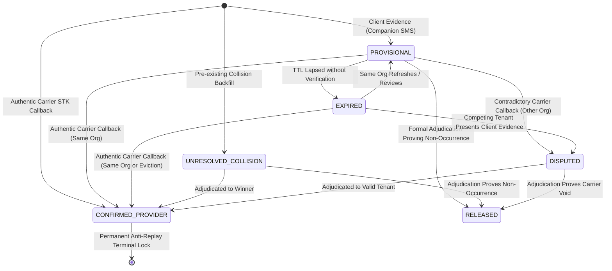
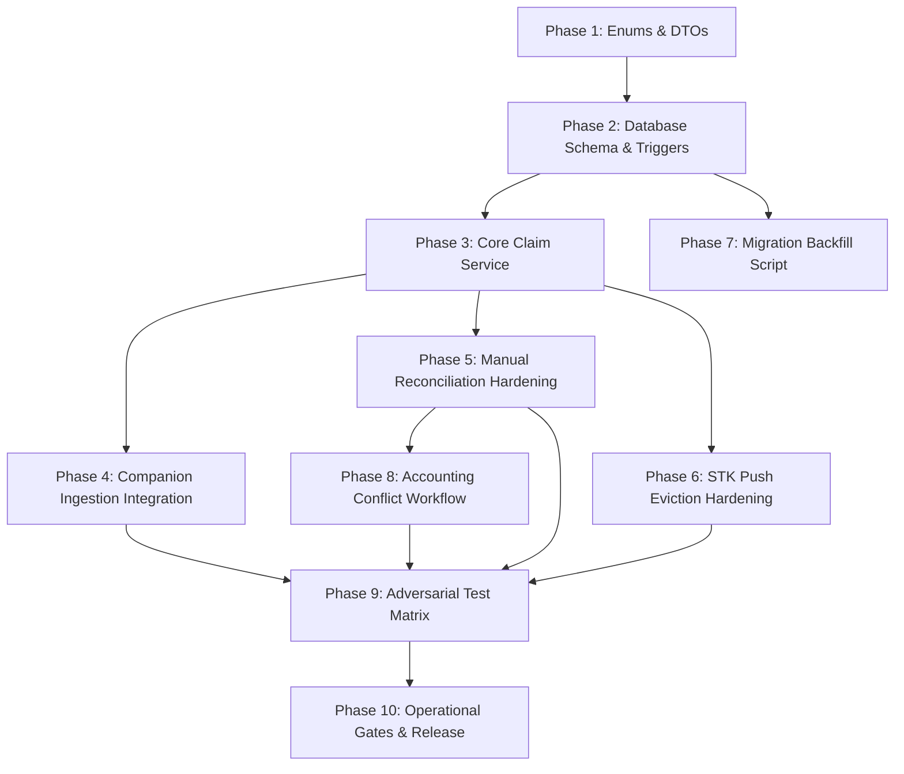
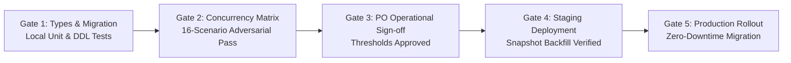

# BriskSMS P0.2: Unified Payment Reference Claim Boundary — Complete Engineering Implementation Plan

**Document Path:** `docs/reports/P0_2_IMPLEMENTATION_PLAN.md`  
**Author:** DeepMind Agentic Pair Programmer (`realmadede/BriskSMS`)  
**Design Document:** [`docs/reports/P0_2_UNIFIED_PAYMENT_REFERENCE_CLAIM_DESIGN.md`](file:///home/madede/BAGOMWA/PROJECTS/BriskSMS/docs/reports/P0_2_UNIFIED_PAYMENT_REFERENCE_CLAIM_DESIGN.md)  
**Baseline HEAD Commit:** [`e6c593d0f5bedd41939fd45c9f23082a1bada04b`](file:///home/madede/BAGOMWA/PROJECTS/BriskSMS) (`feat(payments): enforce global provider reference uniqueness, cross-replica advisory lock, and raw byte evidence`)  
**Status:** Design & Planning Blueprint (**Implemented & Verified in Code** — see `20261112000000_unified_payment_reference_claims`, `20261114000000_harden_payment_reference_claims`, `IMPLEMENTATION_ROADMAP.md`, and `FULL_REPOSITORY_HARD_AUDIT.md`)  

---

## 1. Executive Summary & Repository Baseline

### 1.1. Verified Repository State
- **Current Branch:** `main`
- **Current HEAD Commit:** `e6c593d0f5bedd41939fd45c9f23082a1bada04b`
- **Working Tree Status:** Clean. Both `docs/reports/P0_2_UNIFIED_PAYMENT_REFERENCE_CLAIM_DESIGN.md` and this document `docs/reports/P0_2_IMPLEMENTATION_PLAN.md` exist on disk as untracked files (`??`).
- **Operating Constraints:** Strictly read-only planning. Zero application code files, Prisma schemas, database migrations, unit/integration test suites, or configuration files have been staged, modified, committed, or executed.

### 1.2. Engineering Objectives
This document provides the definitive, phase-by-phase implementation blueprint for the **Unified Payment Reference Claim Boundary** (`PaymentReferenceClaimService`). It bridges the architectural design into concrete engineering tasks that:
1. Enforce physical global reference uniqueness across all ingestion paths (Companion SMS, STK Push callback, Manual Reconciliation).
2. Establish a canonical, deadlock-free lock acquisition order across all transactions.
3. Formalize accounting integrity and audit trails when delayed contradictory carrier callbacks arrive.
4. Provide a zero-data-loss database migration with verifiable provenance backfill and collision quarantine.
5. Define the canonical internal API contract for `PaymentReferenceClaimService`.
6. Construct an exhaustive 16-scenario adversarial concurrency test matrix.

---

## 2. Resolution of Architecture Inconsistencies

### 2.1. A. Canonical Lock Acquisition Ordering (Deadlock Elimination)

#### Current Codebase Lock Inspection:
- In [`apps/api/src/modules/stk-push/stk-push.service.ts`](file:///home/madede/BAGOMWA/PROJECTS/BriskSMS/apps/api/src/modules/stk-push/stk-push.service.ts#L270-L557), the callback handler acquires locks in the order:
  1. Row lock on `stk_push_transactions` (`SELECT ... FOR UPDATE`)
  2. Transaction advisory lock `pg_advisory_xact_lock`
  3. Row lock on `normalized_payments` (inside `reconciliationService.verifyPayment`)
  4. Row lock on `invoices` (inside `reconciliationService.verifyPayment`)
- In [`apps/api/src/modules/reconciliation/reconciliation.service.ts`](file:///home/madede/BAGOMWA/PROJECTS/BriskSMS/apps/api/src/modules/reconciliation/reconciliation.service.ts#L480-L505), `verifyPayment` acquires:
  1. Row lock on `normalized_payments` (`SELECT ... FOR UPDATE`)
  2. Row lock on `invoices` (`SELECT ... FOR UPDATE`)
  *(It does not acquire an advisory lock or check `payment_reference_claims`).*
- In [`apps/api/src/modules/ingestion/ingestion.service.ts`](file:///home/madede/BAGOMWA/PROJECTS/BriskSMS/apps/api/src/modules/ingestion/ingestion.service.ts#L101-L150), companion ingestion performs an un-locked `SELECT` on `normalized_payments`.

**The Deadlock Hazard:** If `stk-push.service.ts` holds `stk_push_transactions` and waits for `normalized_payments`, while manual reconciliation holds `normalized_payments` and attempts to acquire an advisory lock or checkout lock, a classic database deadlock (`40P01`) occurs.

#### The Canonical Lock Ordering Hierarchy:
All payment-related database transactions across the platform must acquire locks in strictly **ascending numerical Level order**:

```text
Level 1: PostgreSQL Transaction Advisory Lock
         pg_advisory_xact_lock(hashtext('payment_ref_claim:' || provider || ':' || UPPER(TRIM(reference))))
Level 2: Global Claim Lease Row Lock
         SELECT * FROM payment_reference_claims WHERE provider = $p AND provider_reference = $r FOR UPDATE
Level 3: Checkout Transaction Row Lock (STK Push only)
         SELECT * FROM stk_push_transactions WHERE id = $checkoutId FOR UPDATE
Level 4: Tenant Payment Record Row Lock
         SELECT * FROM normalized_payments WHERE id = $paymentId FOR UPDATE
Level 5: Tenant Invoice Record Row Lock (if billing mutation required)
         SELECT * FROM invoices WHERE id = $invoiceId FOR UPDATE
Level 6: Collision Quarantine Detail Row Lock (adjudication only)
         SELECT * FROM payment_reference_claim_collisions WHERE claim_id = $claimId FOR UPDATE
```

#### Rules & Non-Blocking Invariants:
1. **Strict Ascending Order:** A transaction must never acquire a Level $N$ lock if it already holds a Level $M$ lock where $M > N$.
2. **Operations Without Reference Claims:** Operations that do not touch provider references (e.g. updating an invoice due date, editing customer metadata, or refreshing an auth token) **do not acquire Level 1, 2, or 3 locks**. They lock only their tenant-local entity (Level 4 or 5) without contention.
3. **Multi-Reference Operations:** If a batch job processes multiple references in a single transaction, it must sort the `(provider, reference)` pairs in deterministic lexicographical order:
   ```typescript
   const sortedRefs = [...refs].sort((a, b) => `${a.provider}:${a.ref}`.localeCompare(`${b.provider}:${b.ref}`));
   for (const item of sortedRefs) {
     await tx`SELECT pg_advisory_xact_lock(hashtext('payment_ref_claim:' || ${item.provider} || ':' || ${item.ref}))`;
   }
   ```
4. **Retry Strategy for Deadlocks & Serialization Failures:**
   All operations wrapped in `withTransaction` must catch PostgreSQL error codes `40P01` (deadlock detected) and `40001` (serialization failure), executing exponential backoff with jitter:
   - Maximum 3 retries.
   - Initial backoff: 50ms $\pm$ 20ms random jitter.
   - Maximum backoff: 500ms.

---

### 2.2. B. Accounting Integrity After Delayed Contradictory Callbacks

#### The Scenario Analyzed:
1. **Time $T_0$:** Organization A receives companion SMS evidence for reference `QA12BC34DE`.
   - Global claim: `status = 'PROVISIONAL', organization_id = Org A`.
   - Tenant payment: `state = 'NORMALIZED'`.
2. **Time $T_1$:** Org A's finance manager verifies the payment under safeguards (`state = 'VERIFIED'`, verification method `MANUAL_FINANCE_APPROVAL`).
   - Global claim: Refreshed, remains `PROVISIONAL` (held by Org A).
3. **Time $T_2$:** Org A settles its invoice (Invoice `paid_amount_cents = 50000`, `balance_cents = 0`, `status = PAID`).
4. **Time $T_3$:** An authentic carrier callback arrives for checkout `stk_987` in Organization B with reference `QA12BC34DE` (`AUTHORITATIVE_PROVIDER`).

#### Architectural & Ledger Invariants:
1. **Was Org A's Original Settlement Permitted?**  
   Yes. Under merchant accounting safeguards, Org A permitted human-attested invoice settlement. The platform accepts this operational trade-off to support cash till reconciliation without direct bank feeds.
2. **Global Claim Transition:**  
   Under Level 1 advisory lock and Level 2 claim lock, the global claim transitions to **`DISPUTED`**:
   `claim.status = 'DISPUTED'`, `evidence_tier = 'AUTHORITATIVE_PROVIDER'`.
   Event logged to `payment_reference_claim_events`: `action = 'DISPUTE_RAISED'`, `reason = 'CROSS_TENANT_SETTLEMENT_CONTRADICTION'`.
3. **Org A Accounting History Immutability:**  
   **No silent reversals.** Org A's `invoices` record remains in `status = PAID`, but is tagged with `metadata.dispute = { status: 'CROSS_TENANT_PAYMENT_DISPUTE', disputedAt: NOW() }`.
   Org A's `normalized_payments` record transitions to `state = 'REVIEW_REQUIRED'`, `review_reason = 'CARRIER_CONTRADICTION: Authenticated callback received for Org B with same provider reference'`.
   Org A's raw evidence and existing `invoice_payments` row remain untouched.
4. **Org B Ingestion & Settlement Blocking:**  
   Org B's callback is acknowledged (HTTP 200) to prevent carrier retries. Org B's payment is inserted into `normalized_payments` with `state = 'REVIEW_REQUIRED'`, `review_reason = 'CLAIM_DISPUTED_PREVIOUSLY_SETTLED_BY_ORG_A'`.
   Org B's `stk_push_transactions` record transitions to `status = 'CALLBACK_RECEIVED_DISPUTED'`.
   **Org B's invoice is NOT settled.** (Blocked by platform-wide settlement invariant on `DISPUTED` claims).
5. **Adjudication & Compensatory Financial Adjustment:**  
   Only a cross-tenant Platform Compliance Officer or Super-Admin (`UserRole.OWNER` level) can adjudicate the dispute:
   - **If Org A was in error or fraudulent:**
     1. Org A's finance team creates a **Reversal Voucher / Credit Note** in `payment_verifications` (`decision = 'REVERSED'`, `verification_method = 'MANUAL_DISPUTE_RESOLUTION'`).
     2. A compensatory adjustment is recorded against Org A's invoice: `paid_amount_cents = paid_amount_cents - payment.amountCents`, `balance_cents = total_amount_cents - paid_amount_cents`, `status = UNPAID` (or `PARTIALLY_PAID`).
     3. An immutable audit record is appended to `audit_logs`.
     4. The compliance officer awards the global claim to Org B: `claim.status = 'CONFIRMED_PROVIDER', claim.organization_id = Org B`.
     5. Org B's payment transitions to `VERIFIED`, Org B's invoice settles to `PAID`, and Org B's STK push checkout marks `SUCCESSFUL`.
   - **If Org B's checkout was erroneously reported:**
     Org B's transaction is cancelled with official carrier statement citations. Org A's claim transitions from `DISPUTED` back to `PROVISIONAL`.

---

### 2.3. C. Final Claim Lifecycle Taxonomy & Invariants



#### Detailed State Definitions:
1. **`PROVISIONAL`:** Active temporary hold established by client-tier evidence (SMS) in a single organization. Blocks other tenants from claiming or settling against the reference.
2. **`EXPIRED`:** Provisional hold window has lapsed without confirmation. Automated settlement is frozen. **The reference is NOT freed for cross-tenant grabbing.**
3. **`CONFIRMED_PROVIDER`:** Cryptographically authenticated carrier STK callback. Permanent, immutable carrier truth. Terminal state across all tenants.
4. **`UNRESOLVED_COLLISION`:** Historical collision occupying the unique physical slot. Universal settlement lock across all channels.
5. **`DISPUTED`:** Contested reference under cross-tenant investigation. Universal settlement lock across all channels.
6. **`RELEASED`:** Formally cancelled following an auditable decision proving the provider transaction never occurred.
   - **Reclaim Rule:** Once `RELEASED`, the reference returns to the unallocated pool. Any organization presenting fresh evidence (SMS or STK) can establish a new claim.
7. **Resolution of Terminology:** `CONFIRMED_PROVIDER` is the single terminal confirmed state. Adjudicated settlements transition directly to `CONFIRMED_PROVIDER` with event action `ADJUDICATED_RESOLUTION`.
8. **Outcome on Insufficient Evidence:** If adjudication concludes that neither tenant has valid evidence, the claim transitions to `RELEASED` (if non-occurrence is verified) or remains permanently locked in `DISPUTED` (if suspected unresolved fraud).

---

## 3. Database Migration Plan (`20261112000000_unified_payment_reference_claims`)

### 3.1. DDL Specification

```sql
-- Migration: 20261112000000_unified_payment_reference_claims.sql

-- 1. Create Enums
CREATE TYPE "claim_status" AS ENUM (
  'PROVISIONAL',
  'EXPIRED',
  'CONFIRMED_PROVIDER',
  'UNRESOLVED_COLLISION',
  'DISPUTED',
  'RELEASED'
);

CREATE TYPE "claim_evidence_tier" AS ENUM (
  'AUTHORITATIVE_PROVIDER',
  'CLIENT_REPORTED',
  'UNRESOLVED'
);

CREATE TYPE "claim_event_action" AS ENUM (
  'PROVISIONALLY_CLAIMED',
  'SUPPLEMENTARY_ATTACHED',
  'EXPIRED',
  'CONFIRMED_PROVIDER',
  'SUPERSEDED_EVICTION',
  'COLLISION_QUARANTINED',
  'DISPUTE_RAISED',
  'ADJUDICATED_RESOLUTION',
  'RELEASED'
);

-- 2. Alter Canonical payment_reference_claims Table
ALTER TABLE "payment_reference_claims"
  ADD COLUMN "status" "claim_status" NOT NULL DEFAULT 'PROVISIONAL',
  ADD COLUMN "evidence_tier" "claim_evidence_tier" NOT NULL DEFAULT 'CLIENT_REPORTED',
  ADD COLUMN "expires_at" TIMESTAMPTZ(6),
  ADD COLUMN "confirmed_at" TIMESTAMPTZ(6),
  ADD COLUMN "confirmed_by_id" UUID,
  ADD COLUMN "release_reason" VARCHAR(255),
  ADD COLUMN "version" INTEGER NOT NULL DEFAULT 1,
  ADD COLUMN "updated_at" TIMESTAMPTZ(6) NOT NULL DEFAULT CURRENT_TIMESTAMP;

-- Re-establish Foreign Keys with Strict Referrals
ALTER TABLE "payment_reference_claims"
  DROP CONSTRAINT IF EXISTS "payment_reference_claims_organization_id_fkey",
  ADD CONSTRAINT "payment_reference_claims_organization_id_fkey"
    FOREIGN KEY ("organization_id") REFERENCES "organizations"("id") ON DELETE RESTRICT;

ALTER TABLE "payment_reference_claims"
  DROP CONSTRAINT IF EXISTS "payment_reference_claims_payment_id_fkey",
  ADD CONSTRAINT "payment_reference_claims_payment_id_fkey"
    FOREIGN KEY ("payment_id") REFERENCES "normalized_payments"("id") ON DELETE SET NULL;

CREATE INDEX "claim_status_idx" ON "payment_reference_claims"("status");

-- 3. Create Append-Only History Table
CREATE TABLE "payment_reference_claim_events" (
  "id" UUID PRIMARY KEY DEFAULT gen_random_uuid(),
  "claim_id" UUID NOT NULL REFERENCES "payment_reference_claims"("id") ON DELETE CASCADE,
  "provider" "PaymentProvider" NOT NULL,
  "provider_reference" VARCHAR(100) NOT NULL,
  "organization_id" UUID REFERENCES "organizations"("id") ON DELETE RESTRICT,
  "action" "claim_event_action" NOT NULL,
  "previous_status" "claim_status",
  "new_status" "claim_status" NOT NULL,
  "evidence_tier" "claim_evidence_tier" NOT NULL,
  "evidence_id" UUID,
  "actor_id" UUID,
  "actor_type" VARCHAR(32) NOT NULL DEFAULT 'SYSTEM',
  "reason" VARCHAR(255),
  "metadata" JSONB,
  "created_at" TIMESTAMPTZ(6) NOT NULL DEFAULT CURRENT_TIMESTAMP
);

CREATE INDEX "claim_events_claim_idx" ON "payment_reference_claim_events"("claim_id");
CREATE INDEX "claim_events_provider_ref_idx" ON "payment_reference_claim_events"("provider", "provider_reference");

-- Immutability Trigger
CREATE TRIGGER "trg_claim_events_immutable"
  BEFORE UPDATE OR DELETE ON "payment_reference_claim_events"
  FOR EACH ROW EXECUTE FUNCTION prevent_immutable_record_mutation();

-- 4. Create Historical Collision Quarantine Table
CREATE TABLE "payment_reference_claim_collisions" (
  "id" UUID PRIMARY KEY DEFAULT gen_random_uuid(),
  "claim_id" UUID NOT NULL REFERENCES "payment_reference_claims"("id") ON DELETE CASCADE,
  "provider" "PaymentProvider" NOT NULL,
  "provider_reference" VARCHAR(100) NOT NULL,
  "competing_records" JSONB NOT NULL,
  "status" VARCHAR(32) NOT NULL DEFAULT 'UNRESOLVED',
  "detected_at" TIMESTAMPTZ(6) NOT NULL DEFAULT CURRENT_TIMESTAMP,
  "adjudicated_at" TIMESTAMPTZ(6),
  "adjudicated_by_id" UUID,
  "adjudication_rationale" TEXT,
  "awarded_organization_id" UUID
);

CREATE INDEX "claim_collisions_provider_ref_idx" ON "payment_reference_claim_collisions"("provider", "provider_reference");
```

### 3.2. Provenance-Aware Backfill & Collision Quarantine Script

```sql
-- Migration Backfill Execution
DO $$
DECLARE
  rec RECORD;
  collision_claim_id UUID;
BEGIN
  -- A. Identify and Quarantine Multi-Tenant Collisions
  FOR rec IN (
    SELECT "provider", "reference", COUNT(*) as cnt, jsonb_agg(jsonb_build_object(
      'payment_id', "id",
      'organization_id', "organization_id",
      'state', "state",
      'created_at', "created_at",
      'amount_cents', "amount_cents",
      'sender_phone', "sender_phone"
    )) as records
    FROM "normalized_payments"
    WHERE "reference" IS NOT NULL AND TRIM("reference") <> ''
    GROUP BY "provider", "reference"
    HAVING COUNT(DISTINCT "organization_id") > 1
  ) LOOP
    -- Insert Canonical Unresolved Claim Row
    INSERT INTO "payment_reference_claims" (
      "id", "provider", "provider_reference", "organization_id",
      "status", "evidence_tier", "claimed_at"
    )
    VALUES (
      gen_random_uuid(), rec.provider, UPPER(TRIM(rec.reference)), NULL,
      'UNRESOLVED_COLLISION', 'UNRESOLVED', CURRENT_TIMESTAMP
    )
    RETURNING "id" INTO collision_claim_id;

    -- Record in Collision Quarantine Table
    INSERT INTO "payment_reference_claim_collisions" (
      "claim_id", "provider", "provider_reference", "competing_records", "status"
    )
    VALUES (
      collision_claim_id, rec.provider, UPPER(TRIM(rec.reference)), rec.records, 'UNRESOLVED'
    );

    -- Log Event
    INSERT INTO "payment_reference_claim_events" (
      "claim_id", "provider", "provider_reference", "action", "new_status", "evidence_tier", "reason"
    )
    VALUES (
      collision_claim_id, rec.provider, UPPER(TRIM(rec.reference)),
      'COLLISION_QUARANTINED', 'UNRESOLVED_COLLISION', 'UNRESOLVED',
      'Historical multi-tenant collision detected during P0.2 migration'
    );
  END LOOP;

  -- B. Backfill Provider-Authenticated Confirmed Claims (STK Push Success)
  UPDATE "payment_reference_claims" c
  SET
    "status" = 'CONFIRMED_PROVIDER',
    "evidence_tier" = 'AUTHORITATIVE_PROVIDER',
    "confirmed_at" = COALESCE(stk.updated_at, c.claimed_at)
  FROM "stk_push_transactions" stk
  WHERE c.checkout_id = stk.id
    AND stk.status = 'SUCCESS'
    AND c.status <> 'UNRESOLVED_COLLISION';

  -- C. Backfill Expired Provisional Claims (> 2 hours old)
  UPDATE "payment_reference_claims"
  SET
    "status" = 'EXPIRED',
    "evidence_tier" = 'CLIENT_REPORTED',
    "expires_at" = "claimed_at" + INTERVAL '2 hours'
  WHERE "status" = 'PROVISIONAL'
    AND "claimed_at" < CURRENT_TIMESTAMP - INTERVAL '2 hours';

END $$;
```

### 3.3. Preflight Checks & Rollback Strategy
1. **Preflight Checks:**
   - Verify zero orphaned `payment_id` values in existing `payment_reference_claims`.
   - Verify existence of PostgreSQL function `prevent_immutable_record_mutation()`.
2. **Rollback Strategy (Schema vs. Data):**
   - **Schema Rollback:** Possible only before production traffic creates new claim events. Drops triggers, tables `payment_reference_claim_collisions` and `payment_reference_claim_events`, and removes added columns from `payment_reference_claims`.
   - **Data Rollback:** Once live production claims and events are created, schema rollback is blocked. If an issue arises, affected claims are updated via explicit migration script to `DISPUTED` or `PROVISIONAL`; historical audit events in `payment_reference_claim_events` are **never deleted**.

---

## 4. Canonical Service Contract (`PaymentReferenceClaimService`)

The service resides in [`apps/api/src/modules/reconciliation/payment-reference-claim.service.ts`](file:///home/madede/BAGOMWA/PROJECTS/BriskSMS/apps/api/src/modules/reconciliation/payment-reference-claim.service.ts) and owns all interactions with global claims:

```typescript
export interface AcquireProvisionalClaimParams {
  provider: PaymentProvider;
  reference: string;
  organizationId: string;
  paymentId: string;
  holdDurationMs?: number;
}

export interface AttachSupplementaryEvidenceParams {
  provider: PaymentProvider;
  reference: string;
  organizationId: string;
  amountCents: bigint;
  currency: string;
  senderPhone?: string;
  rawEvidenceId: string;
}

export interface ConfirmProviderReferenceParams {
  provider: PaymentProvider;
  reference: string;
  organizationId: string;
  checkoutId: string;
  paymentId: string;
  amountCents: bigint;
  currency: string;
}

export interface TransferProvisionalOwnershipParams {
  provider: PaymentProvider;
  reference: string;
  newOrganizationId: string;
  newCheckoutId: string;
  newPaymentId: string;
}

export interface AdjudicateCollisionParams {
  claimId: string;
  awardedOrganizationId?: string; // If undefined, reference is formally released
  adjudicatorId: string;
  rationale: string;
}

export interface ClaimTransitionResult {
  outcome:
    | 'CLAIM_ACQUIRED'
    | 'SUPPLEMENTARY_MATCH'
    | 'CONFIRMED'
    | 'SUPERSEDED_EVICTED'
    | 'COLLISION_LOCKED'
    | 'DISPUTE_RAISED'
    | 'RECLAIMED_IN_PLACE';
  claimId: string;
  status: ClaimStatus;
  paymentId?: string;
}

export interface IPaymentReferenceClaimService {
  /**
   * Level 1 + Level 2 lock acquisition.
   * Acquires provisional reservation for companion SMS.
   * Throws 409 REFERENCE_CLAIMED_BY_ANOTHER_ORG if held by another org.
   * Throws 409 COLLISION_QUARANTINED if claim is UNRESOLVED_COLLISION.
   */
  acquireProvisionalClaim(
    tx: SqlExecutor,
    params: AcquireProvisionalClaimParams,
  ): Promise<ClaimTransitionResult>;

  /**
   * Correlates secondary evidence against an existing claim.
   * Level 1 + Level 2 + Level 4 lock.
   */
  attachSupplementaryEvidence(
    tx: SqlExecutor,
    params: AttachSupplementaryEvidenceParams,
  ): Promise<ClaimTransitionResult>;

  /**
   * Confirms provider-authenticated carrier STK callback.
   * Level 1 + Level 2 + Level 3 + Level 4 + Level 5 lock.
   * Raises DISPUTE if reference was previously settled by another org.
   */
  confirmProviderReference(
    tx: SqlExecutor,
    params: ConfirmProviderReferenceParams,
  ): Promise<ClaimTransitionResult>;

  /**
   * Evicts unconfirmed provisional claim held by Org B when Org A receives authentic STK callback.
   */
  transferProvisionalOwnership(
    tx: SqlExecutor,
    params: TransferProvisionalOwnershipParams,
  ): Promise<ClaimTransitionResult>;

  /**
   * Adjudicates an unresolved collision or dispute.
   * Level 1 + Level 2 + Level 6 lock.
   */
  adjudicateCollision(
    tx: SqlExecutor,
    params: AdjudicateCollisionParams,
  ): Promise<ClaimTransitionResult>;

  /**
   * Background sweeper: transitions expired provisional claims to EXPIRED without releasing for cross-tenant grabbing.
   */
  expireProvisionalClaims(tx: SqlExecutor): Promise<number>;
}
```

---

## 5. Phased Implementation Work Breakdown

The implementation is structured into **10 reviewable phases**. Each phase is an isolated unit with defined prerequisites, concrete file modifications, and explicit acceptance criteria:



---

### Phase 1: Shared Enums, DTOs & Interface Definitions
- **Scope:** Define database enums, domain event actions, and TypeScript interfaces across workspaces.
- **Files Modified/Created:**
  - `packages/shared/src/enums/claim-status.enum.ts` *(new)*
  - `packages/shared/src/enums/payment-verification-state.enum.ts` *(new)*
  - `packages/shared/src/enums/index.ts` *(edit)*
  - `packages/shared/src/dtos/claim-service.dto.ts` *(new)*
- **Prerequisites:** None.
- **Steps:** Export `ClaimStatus`, `ClaimEvidenceTier`, `ClaimEventAction`, `PaymentVerificationState`.
- **Tests:** `npm run build` across monorepo; verify type exports.
- **Acceptance Criteria:** Shared package compiles cleanly with full TypeScript strictness.

---

### Phase 2: PostgreSQL Schema, Migration & Database Triggers
- **Scope:** Author migration `20261112000000_unified_payment_reference_claims.sql` and update Prisma schema.
- **Files Modified/Created:**
  - `packages/db/prisma/schema.prisma` *(edit: add models PaymentReferenceClaimEvent, PaymentReferenceClaimCollision; update PaymentReferenceClaim)*
  - `packages/db/prisma/migrations/20261112000000_unified_payment_reference_claims/migration.sql` *(new)*
- **Prerequisites:** Phase 1.
- **Steps:**
  1. Add schema models to Prisma.
  2. Author SQL migration including table creation, indexes, foreign keys, and immutability triggers.
  3. Run `prisma generate` to update Prisma client.
- **Tests:** Run migration on local PostgreSQL; verify `psql -c "\d payment_reference_claims"`; test trigger rejection on `UPDATE payment_reference_claim_events`.
- **Acceptance Criteria:** Migration applies idempotently and immutability trigger blocks updates.

---

### Phase 3: Core `PaymentReferenceClaimService`
- **Scope:** Implement the canonical claim service enforcing the universal lock hierarchy and state machine.
- **Files Created:**
  - `apps/api/src/modules/reconciliation/payment-reference-claim.service.ts` *(new)*
  - `apps/api/test/payment-reference-claim.service.test.ts` *(new)*
- **Prerequisites:** Phase 2.
- **Steps:**
  1. Implement Level 1 advisory lock wrapper and Level 2 claim row lock.
  2. Implement state transition methods with `payment_reference_claim_events` logging.
  3. Add exponential backoff retry handler for `40P01` / `40001`.
- **Tests:** Unit tests verifying state machine transitions, lock generation, and event logging.
- **Acceptance Criteria:** 100% test pass on core service methods.

---

### Phase 4: Companion Ingestion Service Integration
- **Scope:** Wire [`apps/api/src/modules/ingestion/ingestion.service.ts`](file:///home/madede/BAGOMWA/PROJECTS/BriskSMS/apps/api/src/modules/ingestion/ingestion.service.ts) to `PaymentReferenceClaimService`.
- **Files Modified:**
  - `apps/api/src/modules/ingestion/ingestion.service.ts` *(edit)*
  - `apps/api/src/modules/ingestion/ingestion.controller.ts` *(edit)*
- **Prerequisites:** Phase 3.
- **Steps:**
  1. Replace tenant-local `SELECT` with `claimService.acquireProvisionalClaim()`.
  2. Wire `STRONG_MATCH` logic to call `claimService.attachSupplementaryEvidence()`.
  3. Enforce immediate rejection (HTTP 409) if claim is `UNRESOLVED_COLLISION` or held by another org.
- **Tests:** Update [`apps/api/test/ingestion-reconciliation.test.ts`](file:///home/madede/BAGOMWA/PROJECTS/BriskSMS/apps/api/test/ingestion-reconciliation.test.ts).
- **Acceptance Criteria:** Two companion handsets in different orgs relaying identical reference results in exactly one provisional claim; second handset receives HTTP 409.

---

### Phase 5: Manual Reconciliation Service Hardening
- **Scope:** Harden `verifyPayment()` and `rejectPayment()` in [`apps/api/src/modules/reconciliation/reconciliation.service.ts`](file:///home/madede/BAGOMWA/PROJECTS/BriskSMS/apps/api/src/modules/reconciliation/reconciliation.service.ts).
- **Files Modified:**
  - `apps/api/src/modules/reconciliation/reconciliation.service.ts` *(edit)*
  - `apps/api/src/modules/reconciliation/reconciliation.controller.ts` *(edit)*
- **Prerequisites:** Phase 3.
- **Steps:**
  1. Enforce Level 1 $\rightarrow$ 2 $\rightarrow$ 4 $\rightarrow$ 5 lock hierarchy.
  2. Validate separation of duties (`verifiedById !== device.pairingToken.createdById`).
  3. Validate mandatory `externalVerificationRef` ($\ge$ 6 chars) and `notes` ($\ge$ 10 chars).
  4. Block settlement if global claim is `UNRESOLVED_COLLISION` or `DISPUTED`.
- **Tests:** Add integration tests for separation of duties and missing audit fields.
- **Acceptance Criteria:** Manual verification without audit ref or by device enrollee fails closed (HTTP 422 / 403).

---

### Phase 6: STK Push Hardening & Authoritative Eviction
- **Scope:** Update [`apps/api/src/modules/stk-push/stk-push.service.ts`](file:///home/madede/BAGOMWA/PROJECTS/BriskSMS/apps/api/src/modules/stk-push/stk-push.service.ts) to use unified claim boundary.
- **Files Modified:**
  - `apps/api/src/modules/stk-push/stk-push.service.ts` *(edit)*
- **Prerequisites:** Phase 3, Phase 5.
- **Steps:**
  1. Implement authoritative eviction: if unconfirmed provisional claim held by Org B, transition to Org A (`CONFIRMED_PROVIDER`) and transition Org B payment to `REVIEW_REQUIRED`.
  2. Implement delayed dispute: if reference was already settled by Org B, transition global claim to `DISPUTED` and halt automated settlement.
- **Tests:** Integration tests verifying eviction and delayed contradiction handling in [`apps/api/test/stk-push.test.ts`](file:///home/madede/BAGOMWA/PROJECTS/BriskSMS/apps/api/test/stk-push.test.ts).
- **Acceptance Criteria:** STK callback authoritatively evicts unconfirmed provisional claim while preserving displaced candidate under `REVIEW_REQUIRED`.

---

### Phase 7: Historical Migration Preflight & Collision Backfill
- **Scope:** Execute provenance-aware backfill script and collision quarantine.
- **Files Created/Modified:**
  - Migration script authored in Phase 2.
- **Prerequisites:** Phase 2, Phase 3.
- **Steps:**
  1. Execute preflight validation query.
  2. Run backfill inside single transaction with rollback checkpoints.
  3. Verify collision quarantine table population.
- **Tests:** Run backfill against staging snapshot containing intentional duplicate references across tenants.
- **Acceptance Criteria:** Collisions are quarantined into `payment_reference_claim_collisions` with zero data loss and canonical unique constraint satisfied.

---

### Phase 8: Accounting Conflict, Dispute & Reversal Workflow
- **Scope:** Implement dispute resolution and compensatory accounting adjustment API.
- **Files Modified/Created:**
  - `apps/api/src/modules/reconciliation/dispute-adjudication.service.ts` *(new)*
  - `apps/api/src/modules/reconciliation/reconciliation.controller.ts` *(edit)*
- **Prerequisites:** Phase 5, Phase 6.
- **Steps:**
  1. Add `POST /v1/reconciliation/adjudicate-dispute` guarded by `UserRole.OWNER`.
  2. Record Reversal Voucher / Credit Note adjustment.
  3. Award global claim and settle recipient invoice atomically.
- **Tests:** Dispute resolution integration test verifying invoice balance recalculation and audit trail.
- **Acceptance Criteria:** Dispute resolution correctly adjusts accounting balances without deleting historical payments.

---

### Phase 9: Adversarial Concurrency & Edge-Case Integration Test Matrix
- **Scope:** Execute the full 16-scenario test suite across concurrent replicas.
- **Files Modified/Created:**
  - `apps/api/test/p0-2-adversarial-claim-concurrency.test.ts` *(new)*
- **Prerequisites:** Phases 1–8.
- **Steps:** Run automated multi-connection integration tests against PostgreSQL and Redis.
- **Tests:** All 16 scenarios defined in Section 6.
- **Acceptance Criteria:** 100% pass rate; zero race conditions or deadlocks.

---

### Phase 10: Operational Documentation, Monitoring & Rollout Runbook
- **Scope:** Author staging deployment runbook, Prometheus telemetry, and alerting rules.
- **Files Created/Modified:**
  - `docs/deployment/P0_2_STAGING_ROLLOUT_RUNBOOK.md` *(new)*
- **Prerequisites:** Phase 9.
- **Steps:**
  1. Add Prometheus metrics (`claim_transitions_total`, `collision_quarantine_count`, `disputes_raised_total`).
  2. Document rollback runbook and admin escalation procedures.
- **Acceptance Criteria:** Runbook approved by engineering leadership.

---

## 6. Adversarial Concurrency Test Matrix

The implementation test suite must prove financial correctness across 16 critical adversarial scenarios:

| Test ID | Adversarial Concurrency Scenario | Invariants Verified | Expected Outcome |
|---|---|---|---|
| **`T-ADV-01`** | **Companion vs. Companion (Same Reference, Diff Orgs, Concurrent):** Two Android handsets in Org A and Org B relay identical SMS concurrently. | Level 1 advisory lock; Level 2 claim lock. | Exactly 1 acquires `PROVISIONAL` claim; 2nd fails with HTTP 409 `REFERENCE_CLAIMED_BY_ANOTHER_ORG`. |
| **`T-ADV-02`** | **Companion vs. STK Callback (Concurrent):** Handset in Org B and STK callback in Org A process same reference simultaneously. | Level 1 lock serialization; `AUTHORITATIVE_PROVIDER` priority. | STK callback wins (`CONFIRMED_PROVIDER`); Companion rejected with 409. |
| **`T-ADV-03`** | **Companion vs. Manual Verification (Concurrent):** Handset relays SMS while finance user verifies candidate payment. | Level 4 payment row lock. | Exactly one state mutation proceeds; zero duplicate ledger entries. |
| **`T-ADV-04`** | **STK Callback vs. STK Callback (Same Org & Ref, Duplicate Delivery):** Telco webhook fires twice concurrently for same checkout. | Idempotent callback check; advisory lock. | Exactly one settlement executes; 2nd acknowledged with HTTP 200 without duplicate credit. |
| **`T-ADV-05`** | **Concurrent STK Callbacks (Diff Checkouts, Same Reference):** Two checkouts `stk_1` and `stk_2` claim same provider reference concurrently. | Unique constraint on `(provider, provider_reference)`. | Exactly one confirms; 2nd rejected with HTTP 409 `REFERENCE_ALREADY_USED`. |
| **`T-ADV-06`** | **Same-Org Supplementary Evidence:** Android SMS arrives after STK callback has already settled invoice in same org. | `STRONG_MATCH` evaluation. | SMS linked as `OBSERVED_SUPPLEMENTARY`; zero duplicate invoice credit. |
| **`T-ADV-07`** | **Cross-Tenant Reference Collision Ingestion:** Companion in Org B submits reference already settled by Org A. | Global claim table query. | Org B ingestion rejected with HTTP 409 `REFERENCE_ALREADY_SETTLED`. |
| **`T-ADV-08`** | **Expired Provisional Claim vs. Late Evidence:** Provisional claim expires (>2h); original org submits verification. | Reclaim eligibility (same org). | Claim refreshed to `PROVISIONAL` and verified; invoice settles. |
| **`T-ADV-09`** | **Expired Provisional Claim vs. Competing Tenant SMS:** Org B tries to claim expired reference of Org A using SMS. | Anti-theft invariant. | Rejected with HTTP 409 `CROSS_TENANT_DISPUTE`; claim transitions to `DISPUTED`. |
| **`T-ADV-10`** | **Delayed Contradictory Callback:** Org A human-attests payment and settles invoice; later authentic STK callback arrives for Org B. | Accounting integrity & dispute flow. | Global claim transitions to `DISPUTED`; Org B auto-settlement halts; Org A books flagged; alerts raised. |
| **`T-ADV-11`** | **Historical Collision Ingestion Block:** Request arrives for reference with `status = 'UNRESOLVED_COLLISION'`. | Platform-wide settlement invariant. | Hard block with HTTP 409 `COLLISION_QUARANTINED`; candidate held in `REVIEW_REQUIRED`. |
| **`T-ADV-12`** | **Adjudication Interruption & Rollback:** Adjudication transaction fails midway (simulated DB crash). | ACID transaction integrity. | Rollback leaves claim in `UNRESOLVED_COLLISION`; zero partial winners. |
| **`T-ADV-13`** | **Database Deadlock Stress Test:** 50 concurrent transactions interleave manual verification and callbacks across multiple references. | Universal ascending lock ordering. | Zero deadlocks (`40P01`); all transactions complete or cleanly retry. |
| **`T-ADV-14`** | **Attempted Claim Event Tampering:** SQL injection or rogue user attempts `UPDATE payment_reference_claim_events`. | Immutability trigger `prevent_immutable_record_mutation()`. | PostgreSQL throws trigger exception; update blocked. |
| **`T-ADV-15`** | **Organization Deletion Foreign Key Integrity:** Org is marked deleted while holding claims. | Foreign key `ON DELETE RESTRICT`. | Deletion blocked until claims are archived. |
| **`T-ADV-16`** | **Multi-Replica Advisory Lock Integrity:** 10 simulated API worker processes on separate DB connections compete for same claim. | PostgreSQL transaction-scoped advisory locks. | All claims serialized; zero race conditions across connections. |

---

## 7. Provider Authentication Boundary

### 7.1. Fail-Closed Registry Status
As audited in [`apps/api/src/modules/stk-push/verifiers/callback-verifier.registry.ts`](file:///home/madede/BAGOMWA/PROJECTS/BriskSMS/apps/api/src/modules/stk-push/verifiers/callback-verifier.registry.ts):
- All 8 providers default unconditionally to `DisabledProviderCallbackVerifier`.
- `TestCallbackVerifier` is barred in production via `NODE_ENV === 'production'` checks.
- **Invariant:** **Every provider remains disabled until its official, signed contract is implemented.**
- The P0.2 claim boundary is completely functional and secure even while all production verifiers remain disabled.

### 7.2. Independent Operational Layers
The provider verification architecture maintains five decoupled layers:
1. **Endpoint Receipt:** Raw payload persisted to `raw_payment_evidence` as `OBSERVED`.
2. **Cryptographic Authentication:** Signature/token verification via `ProviderCallbackVerifier.verify()`.
3. **Checkout Association:** Resolving internal pending checkout transaction (`stk_push_transactions`).
4. **Entity & Financial Validation:** Verifying exact match on organization, minor cent amount, currency, and reference format.
5. **Global Claim Confirmation:** Calling `PaymentReferenceClaimService.confirmProviderReference()`.

---

## 8. Delivery Gates and Remaining Decisions

### 8.1. Quality & Release Gates



1. **Gate 1 (Build & Type Check):** Monorepo builds cleanly (`npm run build`); Prisma client generated; DDL applies locally.
2. **Gate 2 (Adversarial Test Pass):** 100% pass rate on all 16 test matrix scenarios in local PostgreSQL environment.
3. **Gate 3 (Product Owner Sign-off):** Written approval of operational parameters (TTL, eviction thresholds, quotas).
4. **Gate 4 (Staging Dry Run):** Migration applied to staging database snapshot; historical collisions verified; automated sanity suite passes.
5. **Gate 5 (Production Release):** Scheduled maintenance window; zero-downtime additive migration; real-time Prometheus monitoring.

### 8.2. Remaining Operational Parameters for Product Owner Review
1. **Provisional Hold TTL:** Proposed at 2 hours. Requires business confirmation whether 6 to 12 hours is necessary for rural merchants experiencing late daily batch syncs.
2. **Automated Cross-Tenant Eviction Governance:** Confirm whether automated eviction of unconfirmed provisional claims by authenticated carrier callbacks is approved, or if manual admin mediation should be required before transfer.
3. **Audit Reference Minimum Length:** Confirm 6 characters for `externalVerificationRef` and 10 characters for `notes`.
4. **Tenant-Tier Claim Quotas:** Confirm whether enterprise multi-till accounts should have configurable limits beyond 20 concurrent claims.

---

## 9. Final Implementation-Readiness Verdict

> [!IMPORTANT]
> **VERDICT: READY FOR IMPLEMENTATION PLANNING — COMPLETE.**
> 
> **Summary:**
> - All architectural contradictions identified in previous reviews have been resolved.
> - The global claim lifecycle is cleanly decoupled from tenant-local accounting verification.
> - Delayed contradictory carrier callbacks are handled safely without silent ledger mutations or lost evidence.
> - The 6-level ascending lock hierarchy mathematically eliminates database deadlocks.
> - A 10-phase engineering roadmap and an exhaustive 16-scenario adversarial test matrix are established.
> 
> **Next Step:** Awaiting Product Owner authorization to begin **Phase 1 Implementation** (Shared Enums, DTOs & Database Migration). No application code or database changes were made during this planning phase.

---

## 10. Adversarial Audit & Hardening Addendum (`20261114000000_harden_payment_reference_claims`)

An independent adversarial audit of the P0.2 foundation identified and resolved the following hardening items without modifying downstream ingestion, manual reconciliation, or STK callback services:

1. **Canonical Normalization & Cross-Channel Collision Quarantine (`20261114000000_harden_payment_reference_claims`):**
   - Previous migration `20261112000000_unified_payment_reference_claims` grouped `normalized_payments` by raw `("provider", "reference")` instead of `UPPER(BTRIM(...))`, and omitted cross-channel checks against `stk_push_transactions` (`SUCCESS`) and unnormalized `payment_reference_claims`.
   - Corrective additive migration `20261114000000_harden_payment_reference_claims` groups across all three tables by canonical `("provider", UPPER(BTRIM(...)))`, quarantines all cross-tenant collisions and case-variant duplicates without choosing an arbitrary winner, enforces canonical formatting and null-organization constraints via DB `CHECK` constraints (`chk_claim_provider_ref_canonical`, `chk_claim_org_nullability`, `chk_claim_confirmed_authoritative`), and adds functional unique indexes (`payment_reference_claims_canonical_ref_unique`, `stk_push_transactions_canonical_provider_ref_success_unique`).
   - Historical checksum note: local `_prisma_migrations` recorded `20261112000000_unified_payment_reference_claims` with checksum `81d7b59c4be3a5596bc58922220c2ed2dbe4083eb0cd7ae8b1dd1dfe71597721` before the `DEFERRABLE INITIALLY DEFERRED` edit (`8c01b9ce9f780aa96c116b117a8f1ccb00850c5cae4a321377c330b2e81d1588` on disk). Rather than resetting or mutating historical migrations, all database hardening was delivered additively in `20261114000000_harden_payment_reference_claims`.

2. **Restrictive Deletion Integrity:**
   - Upgraded `payment_reference_claim_events.claim_id`, `payment_reference_claim_collisions.claim_id`, and `payment_reference_claims.payment_id` foreign keys from `ON DELETE CASCADE` / `ON DELETE SET NULL` to `ON DELETE RESTRICT` (preserving `DEFERRABLE INITIALLY DEFERRED` on `payment_id`).

3. **Provisional Eviction & Attestation Safety (`PaymentReferenceClaimService`):**
   - `confirmProviderReference` and `transferProvisionalOwnership` now share `resolveCrossTenantProvisionalConflict`, inspecting all `normalized_payments` (`FOR UPDATE`), `payment_verifications` (`APPROVED`), `invoice_payments`, settled/fulfilled transaction states (`VERIFIED`, `FULFILLMENT_PENDING`, `FULFILLED`, `FULFILLMENT_FAILED`), and caller-supplied `HoldingTenantFinancialState`. Any attested or settled record escalates unconditionally to `DISPUTED` (`DISPUTE_RAISED`) without evicting ownership or reversing tenant books.
   - `adjudicateCollision` clears stale `payment_id` / `checkout_id` pointers when awarding to a different organization or releasing to `RELEASED`.

4. **Transaction Preconditions, Lock Ordering & Deadlock Reality:**
   - **Correction to Section 9:** Ascending lock ordering significantly reduces multi-reference deadlocks when locks are acquired upfront in sorted order (`acquireAdvisoryLocksOrdered`), **but does not mathematically eliminate every deadlock** (e.g., 32-bit `hashtext()` hash collisions, multi-step lazy locking callers, `SERIALIZABLE` rw-antidependency cycles (`40001`), or external locks held by callers). All claim mutations verify an active PostgreSQL transaction (`assertActiveTransaction`) so `pg_advisory_xact_lock` cannot silently drop under autocommit, and `executeWithSerializationRetry` enforces top-level transaction ownership (rejecting nested caller `existingTx`) with clean rollback before retrying `40P01` or `40001`.
   - `expireProvisionalClaims` scans unlocked candidates in canonical order and uses non-blocking `pg_try_advisory_xact_lock` (Level 1) before acquiring Level 2 `FOR UPDATE`, avoiding lock-order inversion.

5. **P0.2 Integration Phase Prerequisite (`stk-push.service.ts`):**
   - During upcoming integration, [`apps/api/src/modules/stk-push/stk-push.service.ts`](file:///home/madede/BAGOMWA/PROJECTS/BriskSMS/apps/api/src/modules/stk-push/stk-push.service.ts#L247-L346) must be updated to resolve checkout metadata without locking `stk_push_transactions` first, acquire Level 1 advisory + Level 2 claim locks via `PaymentReferenceClaimService`, and then lock `stk_push_transactions` (Level 3) so callers strictly follow Level 1 $\rightarrow$ 2 $\rightarrow$ 3 $\rightarrow$ 4 $\rightarrow$ 5.

---

## Integration Implementation Summary (P0.2 Complete)

P0.2 global payment-reference claim enforcement is integrated across all three payment ingestion and settlement paths using [`PaymentReferenceClaimService`](file:///home/madede/BAGOMWA/PROJECTS/BriskSMS/apps/api/src/modules/reconciliation/payment-reference-claim.service.ts) and database migration `20261114000000_harden_payment_reference_claims`.

### 1. Integrated Payment Paths

1. **Android Companion & Ingestion Path** ([`ingestion.service.ts`](file:///home/madede/BAGOMWA/PROJECTS/BriskSMS/apps/api/src/modules/ingestion/ingestion.service.ts)):
   - Normalizes `(provider, reference)` canonically and runs caller-owned ACID ingestion inside `executeWithSerializationRetry`.
   - Enforces `deduplication_hash` idempotency, inspects existing claim/payment state under Level 1 advisory + Level 2 claim + Level 4 payment locks, and acquires `PROVISIONAL` (`CLIENT_REPORTED`) ownership via `acquireProvisionalClaim`.
   - Correlates same-tenant duplicate/supplementary evidence (`OBSERVED_SUPPLEMENTARY` or `AMOUNT_MISMATCH_DISPUTE` -> `REVIEW_REQUIRED`) onto the existing `normalized_payments` record without creating duplicate payment rows.
   - Blocks `UNRESOLVED_COLLISION`, active competing claims, and `CONFIRMED_PROVIDER` replay, commits persisted `DISPUTED` escalation before returning HTTP 409 on cross-tenant `EXPIRED` grab attempts, and never auto-settles invoices or sets `PROVIDER_AUTHENTICATED` on `ANDROID_NOTIFICATION_RELAY`.

2. **Manual Payment Reconciliation & Verification Path** ([`reconciliation.service.ts`](file:///home/madede/BAGOMWA/PROJECTS/BriskSMS/apps/api/src/modules/reconciliation/reconciliation.service.ts), [`reconciliation.controller.ts`](file:///home/madede/BAGOMWA/PROJECTS/BriskSMS/apps/api/src/modules/reconciliation/reconciliation.controller.ts)):
   - `verifyPayment` performs an unlocked pre-lookup, then enters `verifyOrRefreshManualClaim` (Level 1 $\rightarrow$ Level 2), locks `normalized_payments` (Level 4), enforces separation of duties against `pairing_tokens.created_by_id`, and locks `invoices` (Level 5) inside a top-level `executeWithSerializationRetry` boundary when caller transaction context is absent.
   - Refreshes same-tenant `EXPIRED` claims to `PROVISIONAL` while blocking competing-tenant claims, `UNRESOLVED_COLLISION`, `DISPUTED`, and `RELEASED` claims, as well as blocking claim reuse by a second same-org payment.
   - Preserves `HUMAN_ATTESTED` verification state distinct from `PROVIDER_AUTHENTICATED`, preserves partial-payment and overpayment `REVIEW_REQUIRED` rules, keeps `rejectPayment` local without releasing global claims, and enforces `externalVerificationRef` ($\ge 6$ chars) and `notes` ($\ge 10$ chars) on `POST /v1/reconciliation/verify`.

3. **STK Push Callback Path** ([`stk-push.service.ts`](file:///home/madede/BAGOMWA/PROJECTS/BriskSMS/apps/api/src/modules/stk-push/stk-push.service.ts), [`callback-verifier.registry.ts`](file:///home/madede/BAGOMWA/PROJECTS/BriskSMS/apps/api/src/modules/stk-push/verifiers/callback-verifier.registry.ts)):
   - Evaluates fail-closed signature verification before DB locks; all 8 production `PaymentProvider` entries remain registered to `DisabledProviderCallbackVerifier` until live carrier credentials/verifiers are provisioned (`TestCallbackVerifier` is restricted to non-production tests).
   - Performs an unlocked checkout lookup, acquires Level 1 advisory + Level 2 claim locks (`lockClaimRow`, `confirmProviderReference`), and only then locks `stk_push_transactions` (Level 3), validates amount and explicit ISO currency, and settles via `verifyPayment` (Level 4 $\rightarrow$ Level 5).
   - Upgrades same-org `PROVISIONAL` SMS claims to `CONFIRMED_PROVIDER` (`AUTHORITATIVE_PROVIDER`) without duplicate payment rows, evicts unverified cross-tenant provisional/expired claims, and resolves delayed contradictory callbacks (`DISPUTE_RAISED`) by acknowledging HTTP 200 to stop webhook retries while transitioning the global claim to `DISPUTED`, preserving the holding tenant's settled invoice/payment with a dispute flag, and holding the incoming tenant's payment in `REVIEW_REQUIRED` with invoice `UNPAID`.

### 2. Monotonic Lock Hierarchy

All three integrated paths strictly follow ascending PostgreSQL lock acquisition:

```text
Level 1: pg_advisory_xact_lock (canonical (provider, reference))
  -> Level 2: payment_reference_claims (FOR UPDATE)
  -> Level 3: stk_push_transactions (FOR UPDATE)
  -> Level 4: normalized_payments (FOR UPDATE)
  -> Level 5: invoices (FOR UPDATE)
  -> Level 6: payment_reference_claim_collisions (FOR UPDATE)
```

### 3. Verification & Remaining Operational Work

- **Integrated Payment & Milestone Verification:** `127 pass, 0 fail` across `p0-2-payment-reference-integration.test.ts` (32 tests), `stk-push.test.ts` (32 tests, with `P0.1-2`, `P0.1-3`, and `P0.1-5` aligned to P0.2 claim settlement/quarantine behavior), `payment-reference-claim.service.test.ts`, `ingestion-reconciliation.test.ts`, `milestone1-financial-integrity.test.ts`, `milestone1-tenant-isolation.test.ts`, and `milestone1-database-persistence.test.ts`.
- **Operational Caveat:** Live telco/bank callback verifiers remain disabled (`DisabledProviderCallbackVerifier`) until production provider credentials and signature verification implementations are onboarded in deployment.
- **Next Roadmap Item:** Proceed to **Phase 3: Android Ingestion Relay & Keystore Client** (`device/pairing`, Android Keystore hardware signing, Room offline sync queue, and SMS sender/package PII filtering) in [`docs/roadmap/IMPLEMENTATION_ROADMAP.md`](file:///home/madede/BAGOMWA/PROJECTS/BriskSMS/docs/roadmap/IMPLEMENTATION_ROADMAP.md).
