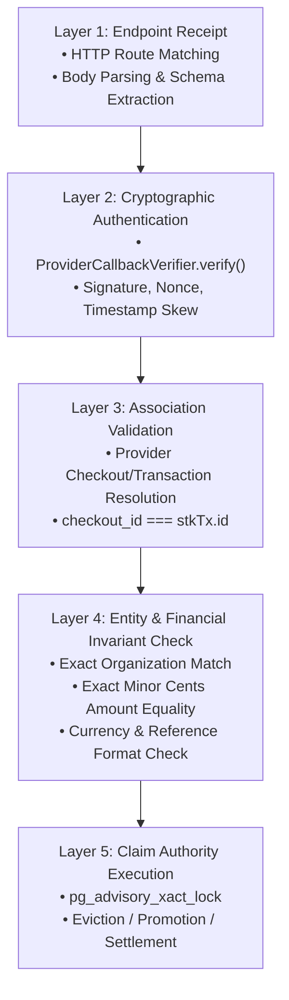
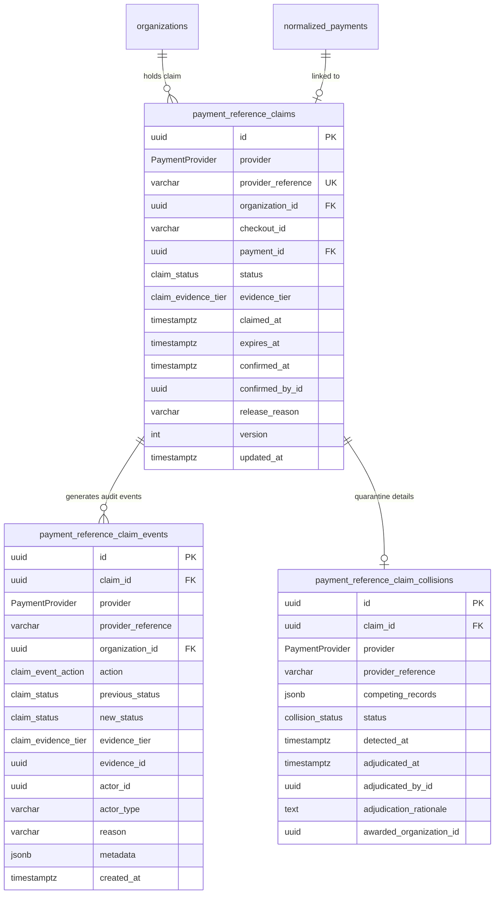
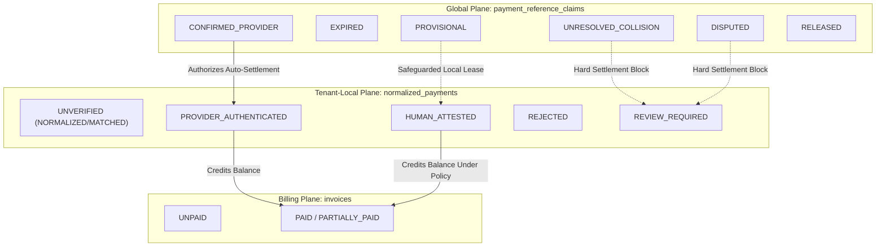
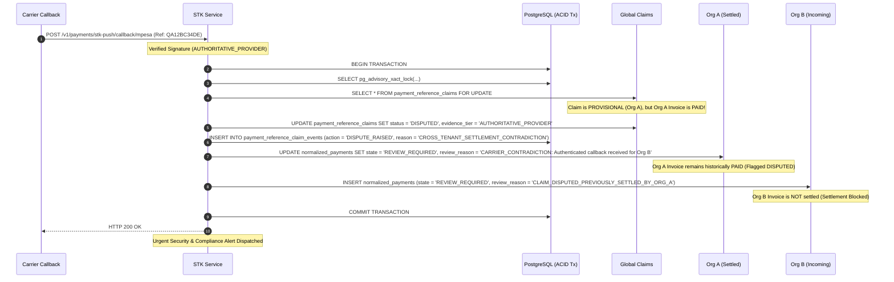
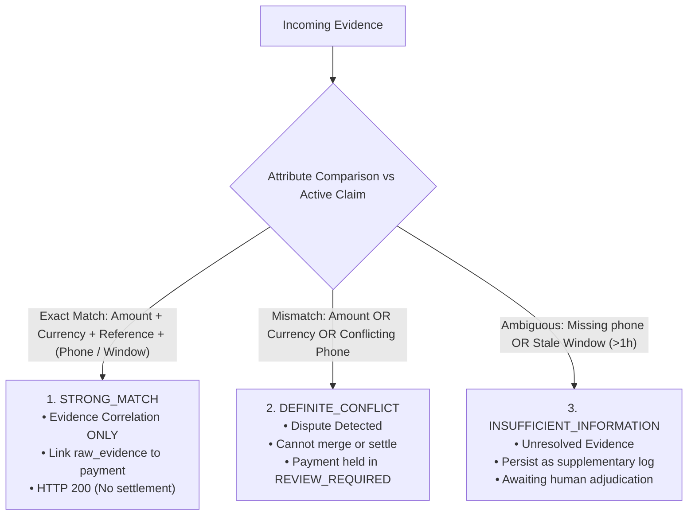

# BriskSMS P0.2: Unified Payment Reference Claim Boundary Final Architecture Specification

**Document Status:** End-to-End Architecture Specification (**Implemented & Verified in Code** — see `PaymentReferenceClaimService`, migrations `20261112000000`/`20261114000000`, `IMPLEMENTATION_ROADMAP.md`, and `FULL_REPOSITORY_HARD_AUDIT.md`)  
**Author:** DeepMind Agentic Pair Programmer (`realmadede/BriskSMS`)  
**Verified Baseline HEAD:** [`e6c593d0f5bedd41939fd45c9f23082a1bada04b`](file:///home/madede/BAGOMWA/PROJECTS/BriskSMS)  
**Primary Report Path:** `docs/reports/P0_2_UNIFIED_PAYMENT_REFERENCE_CLAIM_DESIGN.md`  

---

## 1. Executive Summary & Git Repository State

### 1.1. Verified Git Repository State
The repository baseline was inspected and verified via Git porcelain and plumbing commands:
- **Current Branch:** `main`
- **Current HEAD Commit Hash:** `e6c593d0f5bedd41939fd45c9f23082a1bada04b` (`feat(payments): enforce global provider reference uniqueness, cross-replica advisory lock, and raw byte evidence`)
- **Tracking Status of Report:** The target file `docs/reports/P0_2_UNIFIED_PAYMENT_REFERENCE_CLAIM_DESIGN.md` exists on the local filesystem as an **untracked file** (`??`). It has not been staged (`git add`) or committed to Git HEAD.
- **Git Status Output:**
  ```text
  $ git status --short
  ?? docs/reports/P0_2_UNIFIED_PAYMENT_REFERENCE_CLAIM_DESIGN.md
  ```
- **Git Diff Output:**
  ```text
  $ git diff -- docs/reports/P0_2_UNIFIED_PAYMENT_REFERENCE_CLAIM_DESIGN.md
  # (Empty output: file is untracked in Git index)
  ```
- **Repository Cleanliness:** No tracked application source files, Prisma schemas, SQL migrations, test files, or configuration files have been staged, modified, committed, or reverted. All modifications in this turn are strictly confined to this Markdown design document on the filesystem.

---

### 1.2. Architecture Objective & Summary of Final Design Resolutions

During the adversarial security verification of commit `e6c593d0f5bedd41939fd45c9f23082a1bada04b` (P0.1), three release-critical architectural trust-boundary defects were confirmed:
1. **Companion Ingestion Bypasses Claims & Advisory Locks:** [`apps/api/src/modules/ingestion/ingestion.service.ts`](file:///home/madede/BAGOMWA/PROJECTS/BriskSMS/apps/api/src/modules/ingestion/ingestion.service.ts#L101-L207) does not query, lock, or insert into `payment_reference_claims`, and does not acquire `pg_advisory_xact_lock`.
2. **Manual Reconciliation Verification Operates Outside Claim Boundary:** [`apps/api/src/modules/reconciliation/reconciliation.service.ts`](file:///home/madede/BAGOMWA/PROJECTS/BriskSMS/apps/api/src/modules/reconciliation/reconciliation.service.ts#L470-L585) updates invoice balances and transitions payment states to `VERIFIED` without verifying or registering claim ownership in `payment_reference_claims`.
3. **Tenant-Local Concurrency Race Across Organizations:** Companion ingestion checks for duplicates using an un-locked tenant-local query (`WHERE organization_id = $orgId`). Two companion handsets registered to different organizations can simultaneously ingest and normalize identical carrier references.

This final architecture specification resolves the remaining architectural contradictions:

1. **Separation of Global Ownership from Tenant-Local Verification:** `HELD_HUMAN_ATTESTED` is completely removed from the global claim lifecycle. Global claims represent carrier-level platform uniqueness (`PROVISIONAL`, `EXPIRED`, `CONFIRMED_PROVIDER`, `UNRESOLVED_COLLISION`, `DISPUTED`, `RELEASED`). Tenant payment records represent local accounting state (`UNVERIFIED`, `HUMAN_ATTESTED`, `PROVIDER_AUTHENTICATED`, `REJECTED`, `REVIEW_REQUIRED`).
2. **Resolution of Delayed Contradictory Provider Callbacks:** If an authentic carrier callback arrives for Organization B after Organization A has human-attested and settled an invoice for the same reference, Organization A's historical accounting books are **never silently mutated**. The global claim transitions to `DISPUTED`, Organization B's automated settlement halts, Organization A's payment is flagged `REVIEW_REQUIRED`, and formal cross-tenant administrative adjudication is required.
3. **Reconciled Global Claim and Settlement Invariant:** Universal settlement policy enforced across all channels. Invoices can only settle if the global claim is unconflicted (`CONFIRMED_PROVIDER` for automated settlement, or `PROVISIONAL` held by the same tenant under strict human-attestation safeguards). All settlement is hard-blocked on `UNRESOLVED_COLLISION`, `DISPUTED`, `EXPIRED`, `RELEASED`, or cross-tenant reservations.
4. **Universal Lock-Ordering Hierarchy:** Explicit 6-level lock ordering eliminates database deadlocks across concurrent companion ingestion, manual reconciliation, and carrier callbacks.
5. **Accurate Verification Posture:** Formal recognition that production callback verifiers currently default to disabled, and concurrency properties require implementation and multi-replica testing.

---

## 2. Production Callback Authority: Current Reality vs. Future Capability

A critical finding from our audit of the codebase is the exact status of carrier callback authentication.

### 2.1. Codebase Verification of Current Verifier Registry
Inspecting [`apps/api/src/modules/stk-push/verifiers/callback-verifier.registry.ts:25-41`](file:///home/madede/BAGOMWA/PROJECTS/BriskSMS/apps/api/src/modules/stk-push/verifiers/callback-verifier.registry.ts#L25-L41):
```typescript
public resetToDefaults(): void {
  this.verifiers.clear();
  const providers: PaymentProvider[] = [
    PaymentProvider.MPESA,
    PaymentProvider.MIXX,
    PaymentProvider.AIRTEL_MONEY,
    PaymentProvider.HALOPESA,
    PaymentProvider.TTCL_PESA,
    PaymentProvider.CRDB_BANK,
    PaymentProvider.NMB_BANK,
    PaymentProvider.MANUAL_BANK_TRANSFER,
  ];

  for (const provider of providers) {
    this.verifiers.set(provider, new DisabledProviderCallbackVerifier(provider));
  }
}
```
All eight providers default unconditionally to `DisabledProviderCallbackVerifier`.

Furthermore, inspecting [`apps/api/src/modules/stk-push/verifiers/test-callback.verifier.ts:37-39`](file:///home/madede/BAGOMWA/PROJECTS/BriskSMS/apps/api/src/modules/stk-push/verifiers/test-callback.verifier.ts#L37-L39):
```typescript
if (process.env.NODE_ENV === 'production') {
  throw new Error('SECURITY VIOLATION: TestCallbackVerifier cannot be instantiated in production environment');
}
```
`TestCallbackVerifier` is strictly blocked in production by runtime environment checks.

### 2.2. Honest Architectural Posture
> [!IMPORTANT]
> **Zero production callback verifiers exist today.**  
> The system operates in a strict **fail-closed** mode for all external HTTP STK Push callbacks until official, carrier-certified cryptographic verification contracts (e.g. Vodacom M-Pesa Daraja HMAC/PKI, Airtel Money SHA-256 Webhook Signatures) are authored and registered.

### 2.3. The Five Layers of Callback Ingestion Trust
The P0.2 claim boundary strictly distinguishes five independent operational layers:



1. **Callback Endpoint Receipt:** Receives raw HTTP POST payload from the carrier network. No trust is granted. Raw payload is persisted to `raw_payment_evidence` as `OBSERVED`.
2. **Signature & Authentication Verification:** `ProviderCallbackVerifier.verify()` executes. If the provider uses `DisabledProviderCallbackVerifier`, callback processing halts immediately with HTTP 403 `PROVIDER_CALLBACK_DISABLED`.
3. **Provider and Checkout Association Validation:** Resolves internal checkout transaction (`stk_push_transactions`). Verifies that incoming callback maps to an authentic, pending checkout initiated by the platform.
4. **Organization, Amount, Currency, and Reference Validation:** Verifies that callback's reported amount matches `stkTx.amountCents`, currency matches `stkTx.currency`, and organization matches `stkTx.organizationId`.
5. **Evidence Authorized to Promote or Evict Claims:** Only evidence that has successfully passed Layers 1 through 4 is classified as `AUTHORITATIVE_PROVIDER`.

**Implication for Eviction:** Authoritative cross-tenant eviction of provisional claims is a **dormant architectural capability** that will only trigger in production once official provider verifiers are validated. In the interim, unauthenticated callbacks cannot evict provisional claims or settle invoices.

---

## 3. Current Payment Ingestion & Settlement Call Graph

```mermaid
flowchart TD
    subgraph Channel 1 [Carrier Direct STK Callback - SECURE IN P0.1]
        STK_HTTP["POST /v1/payments/stk-push/callback/:provider"] --> STK_CTRL["stk-push.controller.ts:147"]
        STK_CTRL --> STK_VERIF["ProviderCallbackVerifier.verify()"]
        STK_VERIF -->|Valid Sig| STK_SVC["stk-push.service.ts:handleCarrierCallback()"]
        STK_SVC -->|1. Row Lock| TX_LOCK["SELECT ... FOR UPDATE stk_push_transactions"]
        STK_SVC -->|2. Advisory Lock| ADV_LOCK["pg_advisory_xact_lock(hashtext('payment_ref_claim:...'))"]
        STK_SVC -->|3. Claim Verification| CHECK_CLAIM["SELECT payment_reference_claims WHERE provider + ref"]
        STK_SVC -->|4. Platform-Wide NP Check| CHECK_NP["SELECT normalized_payments WHERE provider + ref"]
        STK_SVC -->|5. Insert Raw Evidence| INSERT_RAW["INSERT raw_payment_evidence"]
        STK_SVC -->|6. Atomic Hard Claim| INSERT_CLAIM["INSERT payment_reference_claims"]
        STK_SVC -->|7. Insert Verified Record| INSERT_NP["INSERT normalized_payments (state: VERIFIED)"]
        STK_SVC -->|8. Auto-Settle Invoice| REC_VERIFY["reconciliation.service.ts:verifyPayment()"]
    end

    subgraph Channel 2 [Android Companion Notification Relay - VULNERABILITY GAP 1]
        COMP_HTTP["POST /v1/ingestion/evidence"] --> COMP_CTRL["ingestion.controller.ts:60"]
        COMP_CTRL --> COMP_SVC["ingestion.service.ts:ingestEvidence()"]
        COMP_SVC --> PARSER["ParserEngine.parse()"]
        COMP_SVC --> HASH["computeDeduplicationHash()"]
        COMP_SVC -->|BYPASS: No Advisory Lock| GAP_ADV["Bypasses pg_advisory_xact_lock"]
        COMP_SVC -->|BYPASS: No Claim Table Check| GAP_CLAIM["Bypasses payment_reference_claims"]
        COMP_SVC -->|Tenant-Local SELECT Only| CHECK_LOCAL["SELECT normalized_payments WHERE org_id = $orgId"]
        CHECK_LOCAL -->|Reads 0 Rows Across Orgs| INSERT_COMP_RAW["INSERT raw_payment_evidence"]
        INSERT_COMP_RAW -->|Duplicate Reference Allowed| INSERT_COMP_NP["INSERT normalized_payments (state: MATCHED/NORMALIZED)"]
    end

    subgraph Channel 3 [Manual Reconciliation Verification - VULNERABILITY GAP 2]
        MAN_HTTP["POST /v1/reconciliation/verify"] --> MAN_CTRL["reconciliation.controller.ts:175"]
        MAN_CTRL --> REC_SVC["reconciliation.service.ts:verifyPayment()"]
        REC_SVC -->|Row Lock Local Payment| NP_LOCK["SELECT FOR UPDATE normalized_payments WHERE id = $id"]
        REC_SVC -->|BYPASS: No Advisory Lock| GAP_REC_ADV["Bypasses pg_advisory_xact_lock"]
        REC_SVC -->|BYPASS: No Claim Table Check| GAP_REC_CLAIM["Bypasses payment_reference_claims"]
        NP_LOCK -->|Settles Invoice Directly| SETTLE_INV["UPDATE invoices balance & INSERT payment_verifications"]
    end
```



---

## 4. Identified Bypasses and Their Financial Consequences

### 4.1. Bypass 1: Companion Ingestion Bypasses Claims and Advisory Locking
- **Source Citation:** [`apps/api/src/modules/ingestion/ingestion.service.ts:101-110`](file:///home/madede/BAGOMWA/PROJECTS/BriskSMS/apps/api/src/modules/ingestion/ingestion.service.ts#L101-L110)
- **Vulnerability Mechanism:**
  ```typescript
  const existingRows = await tx`
    SELECT * FROM "normalized_payments"
    WHERE "organization_id" = ${dto.organizationId}
      AND (
        "deduplication_hash" = ${deduplicationHash}
        OR ("provider" = ${parsed.provider}::"PaymentProvider" AND "reference" = ${parsed.reference})
      )
    LIMIT 1
  `;
  ```
  1. The query strictly filters by `organization_id = ${dto.organizationId}`.
  2. The service neither checks nor inserts into `payment_reference_claims`.
  3. The service does not acquire `pg_advisory_xact_lock`.
- **Financial Consequence:** If Organization A receives payment `QA12BC34DE` via STK Push or Companion Relay, an Android handset registered to Organization B can submit an identical reference `QA12BC34DE`. Ingestion in Organization B succeeds, creating a candidate `normalized_payments` record in Organization B.

### 4.2. Bypass 2: Manual Verification Operates Without Claim Boundary
- **Source Citation:** [`apps/api/src/modules/reconciliation/reconciliation.service.ts:479-509`](file:///home/madede/BAGOMWA/PROJECTS/BriskSMS/apps/api/src/modules/reconciliation/reconciliation.service.ts#L479-L509)
- **Vulnerability Mechanism:**
  `reconciliationService.verifyPayment()` queries and locks `normalized_payments` by primary key `id` and `organization_id`. It does not check whether `(payment.provider, payment.reference)` has already been claimed or confirmed by another organization or another checkout.
- **Financial Consequence:** Organization B's accountant can click "Verify Payment" on the candidate payment generated in Bypass 1. The invoice in Organization B is marked `PAID`, its balance is credited, and downstream webhooks/automations trigger. **The same real-world carrier reference settles two distinct invoices in two distinct organizations.**

### 4.3. Bypass 3: Companion-to-Companion Concurrency Race
- **Source Citation:** [`apps/api/src/modules/ingestion/ingestion.service.ts:101-180`](file:///home/madede/BAGOMWA/PROJECTS/BriskSMS/apps/api/src/modules/ingestion/ingestion.service.ts#L101-L180)
- **Vulnerability Mechanism:**
  In `ingestionService.ingestEvidence()`, the duplicate check is an un-locked `SELECT` executed under default PostgreSQL `READ COMMITTED` isolation. `normalized_payments` only enforces a unique constraint on `(organization_id, deduplication_hash)`. It enforces **no unique constraint on `(provider, reference)` or `(organization_id, provider, reference)`**.
- **Financial Consequence:** If two companion handsets relay notifications for the same transaction concurrently, and their timestamps vary slightly (causing `computeDeduplicationHash` to differ), both `SELECT` queries find 0 rows, and both insert duplicate rows into `normalized_payments`.

---

## 5. Database Architecture: Architecture A with Canonical Quarantine

In P0.1, the database established:
```sql
CONSTRAINT "payment_reference_claims_unique" UNIQUE ("provider", "provider_reference")
```

### 5.1. Preserving Unconditional Uniqueness via Architecture A
We formally adopt **Architecture A**:
- **Single Canonical Record:** `payment_reference_claims` holds exactly one row per claimed provider reference, backed by the unconditional constraint `UNIQUE(provider, provider_reference)`.
- **Immutable Event History:** `payment_reference_claim_events` records every state mutation append-only, guarded by the PostgreSQL trigger `prevent_immutable_record_mutation()`.
- **Zero Historical Table Bloat:** Reclaiming or releasing references does not generate duplicate rows in the primary lease table.
- **Deterministic Locking:** `SELECT ... FOR UPDATE` locks the canonical physical record.



### 5.2. Exact Table Schema & DDL Specifications

```sql
-- Global Claim Enums (Strictly Carrier/Platform Unique Lease States)
CREATE TYPE "claim_status" AS ENUM (
  'PROVISIONAL',
  'EXPIRED',
  'CONFIRMED_PROVIDER',
  'UNRESOLVED_COLLISION',
  'DISPUTED',
  'RELEASED'
);

CREATE TYPE "claim_evidence_tier" AS ENUM (
  'AUTHORITATIVE_PROVIDER',
  'CLIENT_REPORTED',
  'UNRESOLVED'
);

CREATE TYPE "claim_event_action" AS ENUM (
  'PROVISIONALLY_CLAIMED',
  'SUPPLEMENTARY_ATTACHED',
  'EXPIRED',
  'CONFIRMED_PROVIDER',
  'SUPERSEDED_EVICTION',
  'COLLISION_QUARANTINED',
  'DISPUTE_RAISED',
  'ADJUDICATED_RESOLUTION',
  'RELEASED'
);

-- Tenant-Local Payment Verification Enums
CREATE TYPE "payment_verification_state" AS ENUM (
  'UNVERIFIED',
  'HUMAN_ATTESTED',
  'PROVIDER_AUTHENTICATED',
  'REJECTED',
  'REVIEW_REQUIRED'
);

-- 1. Canonical Global Lease Table
CREATE TABLE "payment_reference_claims" (
  "id" UUID PRIMARY KEY DEFAULT gen_random_uuid(),
  "provider" "PaymentProvider" NOT NULL,
  "provider_reference" VARCHAR(100) NOT NULL,
  "organization_id" UUID REFERENCES "organizations"("id") ON DELETE RESTRICT,
  "checkout_id" VARCHAR(64),
  "payment_id" UUID REFERENCES "normalized_payments"("id") ON DELETE SET NULL,
  "status" "claim_status" NOT NULL DEFAULT 'PROVISIONAL',
  "evidence_tier" "claim_evidence_tier" NOT NULL DEFAULT 'CLIENT_REPORTED',
  "claimed_at" TIMESTAMPTZ(6) NOT NULL DEFAULT CURRENT_TIMESTAMP,
  "expires_at" TIMESTAMPTZ(6),
  "confirmed_at" TIMESTAMPTZ(6),
  "confirmed_by_id" UUID,
  "release_reason" VARCHAR(255),
  "version" INTEGER NOT NULL DEFAULT 1,
  "updated_at" TIMESTAMPTZ(6) NOT NULL DEFAULT CURRENT_TIMESTAMP,
  CONSTRAINT "payment_reference_claims_unique" UNIQUE ("provider", "provider_reference")
);

CREATE INDEX "claim_org_idx" ON "payment_reference_claims"("organization_id");
CREATE INDEX "claim_status_idx" ON "payment_reference_claims"("status");

-- 2. Append-Only Event History Table
CREATE TABLE "payment_reference_claim_events" (
  "id" UUID PRIMARY KEY DEFAULT gen_random_uuid(),
  "claim_id" UUID NOT NULL REFERENCES "payment_reference_claims"("id") ON DELETE CASCADE,
  "provider" "PaymentProvider" NOT NULL,
  "provider_reference" VARCHAR(100) NOT NULL,
  "organization_id" UUID REFERENCES "organizations"("id") ON DELETE RESTRICT,
  "action" "claim_event_action" NOT NULL,
  "previous_status" "claim_status",
  "new_status" "claim_status" NOT NULL,
  "evidence_tier" "claim_evidence_tier" NOT NULL,
  "evidence_id" UUID,
  "actor_id" UUID,
  "actor_type" VARCHAR(32) NOT NULL DEFAULT 'SYSTEM',
  "reason" VARCHAR(255),
  "metadata" JSONB,
  "created_at" TIMESTAMPTZ(6) NOT NULL DEFAULT CURRENT_TIMESTAMP
);

CREATE INDEX "claim_events_claim_idx" ON "payment_reference_claim_events"("claim_id");
CREATE INDEX "claim_events_provider_ref_idx" ON "payment_reference_claim_events"("provider", "provider_reference");

-- Immutability Trigger
CREATE TRIGGER "trg_claim_events_immutable"
  BEFORE UPDATE OR DELETE ON "payment_reference_claim_events"
  FOR EACH ROW EXECUTE FUNCTION prevent_immutable_record_mutation();

-- 3. Collision Quarantine Detail Table
CREATE TABLE "payment_reference_claim_collisions" (
  "id" UUID PRIMARY KEY DEFAULT gen_random_uuid(),
  "claim_id" UUID NOT NULL REFERENCES "payment_reference_claims"("id") ON DELETE CASCADE,
  "provider" "PaymentProvider" NOT NULL,
  "provider_reference" VARCHAR(100) NOT NULL,
  "competing_records" JSONB NOT NULL,
  "status" VARCHAR(32) NOT NULL DEFAULT 'UNRESOLVED',
  "detected_at" TIMESTAMPTZ(6) NOT NULL DEFAULT CURRENT_TIMESTAMP,
  "adjudicated_at" TIMESTAMPTZ(6),
  "adjudicated_by_id" UUID,
  "adjudication_rationale" TEXT,
  "awarded_organization_id" UUID
);

CREATE INDEX "claim_collisions_provider_ref_idx" ON "payment_reference_claim_collisions"("provider", "provider_reference");
```

---

## 6. Separation of Global Reference Claims from Tenant-Local Verification

A fundamental principle of the P0.2 architecture is the strict decoupling of **Global Reference Claims** from **Tenant-Local Payment Verification**:



### 6.1. Orthogonal State Machine Definitions

#### Plane 1: Global Reference Claims (`payment_reference_claims`)
Maintains physical carrier reference uniqueness across all tenants:
- **`PROVISIONAL`:** Active reservation established by client-tier evidence (SMS) in one organization. Settlement blocked for all other tenants.
- **`EXPIRED`:** Reservation window lapsed. Automated settlement blocked. **Not freed for cross-tenant acquisition.**
- **`CONFIRMED_PROVIDER`:** Cryptographically authenticated carrier STK callback. Permanent, immutable carrier truth. Terminal state.
- **`UNRESOLVED_COLLISION`:** Historical collision occupying the unique physical slot. Universal settlement lock across all channels.
- **`DISPUTED`:** Contested reference under cross-tenant investigation. All settlement frozen.
- **`RELEASED`:** Formally cancelled following an auditable decision proving the provider transaction never occurred.

#### Plane 2: Tenant-Local Payment Verification (`normalized_payments`)
Maintains merchant accounting status within a single organization:
- **`UNVERIFIED`:** Candidate payment awaiting automatic match or review.
- **`HUMAN_ATTESTED`:** Verified by merchant finance user with mandatory external reference and notes. Does **not** mutate the global claim to confirmed carrier truth.
- **`PROVIDER_AUTHENTICATED`:** Verified by authentic carrier callback.
- **`REJECTED`:** Rejected by merchant finance user. Does **not** prove provider-side non-occurrence.
- **`REVIEW_REQUIRED`:** Discrepancy, collision, or cross-tenant dispute requiring human investigation.

---

## 7. Resolution of Delayed Contradictory Provider Callbacks

### 7.1. The Conflict Scenario
1. **Time $T_0$:** Organization A receives companion SMS evidence for reference `QA12BC34DE`.
   - Global claim: `PROVISIONAL` (held by Org A).
   - Org A payment: `UNVERIFIED` (`MATCHED`).
2. **Time $T_1$:** Org A's finance user human-attests the payment under strict safeguards (`HUMAN_ATTESTED`).
   - Global claim remains `PROVISIONAL` (held by Org A).
3. **Time $T_2$:** Org A settles its invoice (Invoice `status = PAID`).
4. **Time $T_3$:** An authentic carrier callback arrives for checkout `stk_987` in Organization B with reference `QA12BC34DE`.
   - Callback passes cryptographic verification (`AUTHORITATIVE_PROVIDER`).

### 7.2. Exact Operational Resolution



1. **Was Org A's Original Settlement Permitted?**  
   Yes. Under merchant accounting safeguards, Org A permitted human-attested invoice settlement. The business accepts this operational trade-off in exchange for supporting cash/till reconciliation without direct bank feeds.
2. **Global Claim Mutation:**  
   The claim transitions from `PROVISIONAL` to **`DISPUTED`**.
3. **Preservation of Org A Historical Books:**  
   **Zero silent accounting reversals.** Org A's invoice remains in its historical ledger state, but is flagged with `dispute_status = 'CROSS_TENANT_PAYMENT_DISPUTE'`. Org A's payment transitions to `REVIEW_REQUIRED`. All raw evidence is immutably preserved.
4. **Processing of Org B Payment:**  
   Org B's callback is acknowledged (HTTP 200) to prevent carrier webhook retries. Org B's payment is inserted into `normalized_payments` with `state = 'REVIEW_REQUIRED'`. **Org B's invoice is NOT settled.**
5. **Adjudication Authority & Correction:**  
   - Only a cross-tenant Platform Compliance Officer or Super-Admin (`UserRole.OWNER` cross-tenant authorization) can adjudicate.
   - If Org A's human attestation was fraudulent or mistaken: Org A's finance manager must issue an accounting Credit Note / Reversal Voucher, and the compliance officer adjudicates the global claim to Org B (`CONFIRMED_PROVIDER`), authorizing Org B to settle its invoice.
   - If Org B's checkout was erroneously linked: Org B's checkout is cancelled with recorded carrier statements.
6. **Honest Operational Trade-off:**  
   Allowing human-attested settlement on client-reported evidence **inherently accepts the residual risk of delayed contradictory carrier evidence**. Organizations requiring zero dispute risk must disable manual SMS reconciliation and operate strictly on provider callbacks.

---

## 8. Reconciled Global Claim and Settlement Authorization Policy

### 8.1. The Platform-Wide Settlement Authorization Matrix

An invoice in Organization $T$ may only be settled by payment record $P$ when both the **Global Reference Claim** and **Tenant-Local Payment Verification** satisfy the following matrix:

| Global Claim Status (`payment_reference_claims`) | Claim Org Match | Tenant Payment Verification (`normalized_payments`) | Permitted Invoicing Action | Fulfillment Authorized? |
|---|---|---|---|---|
| **`CONFIRMED_PROVIDER`** | `claim.org_id === T.id` | `PROVIDER_AUTHENTICATED` | **Immediate Automated Settlement** (Invoice `status = PAID`). | **YES** |
| **`PROVISIONAL`** | `claim.org_id === T.id` | `HUMAN_ATTESTED` | **Manual Local Settlement Permitted** (Under tenant safeguards). | Tenant-Policy Gated (Low-risk only). |
| **`PROVISIONAL`** | `claim.org_id === T.id` | `UNVERIFIED` | **NO.** Invoicing mutation blocked. | **NO** |
| **`CONFIRMED_PROVIDER`** | `claim.org_id !== T.id` | *(Any)* | **HARD BLOCK (HTTP 409).** Reference settled by another org. | **NO** |
| **`PROVISIONAL`** | `claim.org_id !== T.id` | *(Any)* | **HARD BLOCK (HTTP 409).** Reference held by another org. | **NO** |
| **`EXPIRED`** | `claim.org_id === T.id` | `HUMAN_ATTESTED` | **Permitted upon claim refresh** (Same tenant re-evaluates). | Tenant-Policy Gated. |
| **`EXPIRED`** | `claim.org_id !== T.id` | `CLIENT_REPORTED` | **HARD BLOCK (HTTP 409).** Cross-tenant grab rejected; triggers `DISPUTED`. | **NO** |
| **`UNRESOLVED_COLLISION`** | *(Any)* | *(Any)* | **UNIVERSAL HARD BLOCK (HTTP 409).** Quarantined. | **NO** |
| **`DISPUTED`** | *(Any)* | *(Any)* | **UNIVERSAL HARD BLOCK (HTTP 409).** Frozen pending audit. | **NO** |
| **`RELEASED`** | *(None)* | *(Any)* | **NO.** Claim must be freshly acquired before settlement. | **NO** |

---

## 9. Universal Lock-Ordering Hierarchy & Seven Transaction Specifications

### 9.1. Universal Lock-Ordering Hierarchy (Deadlock Prevention)
To mathematically prevent database deadlocks across concurrent companion ingestion, STK Push callbacks, and manual reconciliation, all database transactions must acquire locks in strictly ascending numerical Level order (Level 1 $\rightarrow$ Level 2 $\rightarrow$ Level 3 $\rightarrow$ Level 4 $\rightarrow$ Level 5 $\rightarrow$ Level 6):

```text
Level 1: PostgreSQL Transaction Advisory Lock
         pg_advisory_xact_lock(hashtext('payment_ref_claim:' || provider || ':' || reference))
Level 2: Global Claim Lease Row Lock
         SELECT * FROM payment_reference_claims WHERE provider = $p AND provider_reference = $r FOR UPDATE
Level 3: Checkout Transaction Row Lock (if applicable)
         SELECT * FROM stk_push_transactions WHERE id = $checkoutId FOR UPDATE
Level 4: Tenant Payment Record Row Lock
         SELECT * FROM normalized_payments WHERE id = $paymentId FOR UPDATE
Level 5: Tenant Invoice Record Row Lock (if applicable)
         SELECT * FROM invoices WHERE id = $invoiceId FOR UPDATE
Level 6: Collision Quarantine Detail Row Lock (if applicable)
         SELECT * FROM payment_reference_claim_collisions WHERE claim_id = $claimId FOR UPDATE
```

---

### 9.2. Corrected Specifications for the Seven Core Operations

#### Specification 1: Creating a Provisional Claim
- **Trigger:** Companion Android SMS notification parsed successfully.
- **Lock Ordering:** Level 1 $\rightarrow$ Level 2.
- **Preconditions:** Reference string is valid; no active claim exists for another organization.
- **State Transitions:**
  - If no row exists: Insert `payment_reference_claims` with `status = 'PROVISIONAL', organization_id = $orgId, evidence_tier = 'CLIENT_REPORTED', expires_at = NOW() + INTERVAL '2 hours'`.
  - Insert `normalized_payments` with `state = 'NORMALIZED'` (Tenant plane: `UNVERIFIED`).
- **Rollback Behavior:** Failure rolls back transaction atomically; zero partial claims created.
- **Idempotency:** Replay with identical hash is rejected via `deduplication_hash` unique index.

#### Specification 2: Attaching Supplementary Evidence
- **Trigger:** Secondary SMS or receipt arrives for an existing active claim in the same organization.
- **Lock Ordering:** Level 1 $\rightarrow$ Level 2 $\rightarrow$ Level 4.
- **Preconditions:** `claim.organization_id === $orgId`.
- **State Transitions:**
  - Evaluates `STRONG_MATCH` rules.
  - If match: Inserts `raw_payment_evidence` marked `parse_status = 'OBSERVED_SUPPLEMENTARY'` and links to `payment_id`. Payment and claim states remain unchanged.
  - If conflict: Marks raw evidence `AMOUNT_MISMATCH_DISPUTE`, updates payment to `REVIEW_REQUIRED`, does not merge.
- **Rollback Behavior:** Failure leaves existing payment and claim completely unmodified.

#### Specification 3: Expiring a Provisional Claim
- **Trigger:** Background sweeper worker or eager check on encountering `expires_at < NOW()`.
- **Lock Ordering:** Level 1 $\rightarrow$ Level 2.
- **Preconditions:** Current `claim.status === 'PROVISIONAL'`.
- **State Transitions:**
  - Global claim: `status = 'EXPIRED'`. Leaves `organization_id` intact.
  - **Does NOT delete the row, and does NOT release the reference for cross-tenant grabbing.**
- **Rollback Behavior:** Failure leaves claim in `PROVISIONAL`.

#### Specification 4: Resolving a Historical Collision
- **Trigger:** Platform administrator adjudicates a collision in `payment_reference_claim_collisions`.
- **Lock Ordering:** Level 1 $\rightarrow$ Level 2 $\rightarrow$ Level 6.
- **Preconditions:** Current `claim.status === 'UNRESOLVED_COLLISION'`. Valid adjudication rationale provided.
- **State Transitions:**
  - Global claim: `status = 'CONFIRMED_PROVIDER', organization_id = $awardedOrgId`.
  - Collision detail: `status = 'RESOLVED', adjudicated_by_id = $adminId, adjudication_rationale = $notes`.
- **Rollback Behavior:** On error, the claim remains `UNRESOLVED_COLLISION`; no partial winner is recorded.

#### Specification 5: Confirming an Authenticated Provider Reference
- **Trigger:** Authentic carrier STK callback arrives for a pending platform checkout.
- **Lock Ordering:** Level 1 $\rightarrow$ Level 2 $\rightarrow$ Level 3 $\rightarrow$ Level 4 $\rightarrow$ Level 5.
- **Preconditions:** Callback passes Layers 1–4. No conflicting settled claim exists.
- **State Transitions:**
  - Global claim: Inserted or updated to `status = 'CONFIRMED_PROVIDER', evidence_tier = 'AUTHORITATIVE_PROVIDER'`.
  - Tenant payment: Inserted with `state = 'VERIFIED'` (Tenant plane: `PROVIDER_AUTHENTICATED`).
  - Tenant invoice: Balance credited; `status = 'PAID'` (or `PARTIALLY_PAID`).
- **Rollback Behavior:** Failure rolls back invoice credit and claim confirmation; carrier receives HTTP 500.

#### Specification 6: Transferring Provisional Ownership (Authoritative Eviction)
- **Trigger:** Authentic carrier STK callback arrives for Org A, but an unconfirmed `PROVISIONAL` claim exists for Org B (with Org B invoice UNPAID).
- **Lock Ordering:** Level 1 $\rightarrow$ Level 2 $\rightarrow$ Level 3 $\rightarrow$ Level 4 $\rightarrow$ Level 5.
- **Preconditions:** Callback passes Layers 1–4. Org B invoice is NOT paid.
- **State Transitions:**
  - Global claim: Updated to Org A: `status = 'CONFIRMED_PROVIDER', evidence_tier = 'AUTHORITATIVE_PROVIDER'`.
  - Org B candidate payment: `state = 'REVIEW_REQUIRED'` (reason: `CLAIM_SUPERSEDED: Contested reference claimed by another org`). Contested reference detached.
  - Org B raw evidence: Preserved immutably.
  - Org A payment: `PROVIDER_AUTHENTICATED`. Org A invoice settled.
- **Rollback Behavior:** Complete rollback leaves Org B's provisional claim intact.

#### Specification 7: Human-Attested Invoice Settlement
- **Trigger:** Authorized user calls `POST /v1/reconciliation/verify`.
- **Lock Ordering:** Level 1 $\rightarrow$ Level 2 $\rightarrow$ Level 4 $\rightarrow$ Level 5.
- **Preconditions:**
  - User role is `OWNER`, `ADMIN`, or `FINANCE`.
  - Separation of duties: `verifiedById !== device.pairingToken.createdById`.
  - Mandatory `externalVerificationRef` (min 6 chars) and `notes` (min 10 chars).
  - Global claim belongs to `$orgId` and is `PROVISIONAL` or `EXPIRED`.
- **State Transitions:**
  - Global claim: Refreshed `claimed_at = NOW()`, remains `PROVISIONAL` (held by `$orgId`).
  - Tenant payment: `state = 'VERIFIED'` (Tenant plane: `HUMAN_ATTESTED`).
  - Tenant invoice: Balance credited; `status = 'PAID'` (or `PARTIALLY_PAID`).
- **Rollback Behavior:** Failure leaves invoice balance and payment state unmodified.

---

## 10. Operational Thresholds & Defensive Anti-Squatting Quarantine

### 10.1. Provisional Operational Parameters

| Parameter | Proposed Value | Status | Operational Justification |
|---|---|---|---|
| **Provisional Hold TTL** | **2 Hours** | *Provisional Proposal (Requires PO Approval & Testing)* | Balances customer checkout abandonment against delayed offline device sync. Configurable per tenant tier. |
| **Eviction Threshold** | **3 Evictions per 24 Hours** | *Provisional Proposal (Requires Testing)* | Triggers evidence quarantine when a device repeatedly submits references evicted by authentic carrier callbacks. |
| **Active Provisional Quota** | **20 per Device/Org** | *Provisional Proposal (Requires PO Approval)* | Cap to prevent rogue companion scripts from flooding unverified claims. Enterprise tiers require higher limits. |
| **Timestamp Tolerance Window** | **1 Hour** (3600 seconds) | *Provisional Proposal (Requires Testing)* | **Handset timestamps are non-authoritative.** Local device clocks drift and cellular SMS can be queued by carriers during outages. |
| **Min External Reference Length** | **6 Characters** | *Provisional Proposal* | Blocks trivial placeholder values (`OK`, `N/A`) in manual reconciliation. |
| **Min Audit Notes Length** | **10 Characters** | *Provisional Proposal* | Enforces meaningful human explanation in manual reconciliation. |

### 10.2. Phased Device Quarantine Architecture
To eliminate Denial-of-Service attacks where an attacker extracts public till receipts and triggers STK evictions to shut down an honest merchant's devices:
1. **Evictions 1 & 2:** Security warnings emitted; provisional claims evicted normally.
2. **Eviction 3 (within 24 hours):** Device status transitions to `QUARANTINED` (not `REVOKED`).
3. **Quarantine Ingestion Behavior:**
   - Ingested SMS notifications from a quarantined device are accepted with HTTP 200 and persisted immutably in `raw_payment_evidence` (`parse_status = 'DEVICE_QUARANTINED'`).
   - **No provisional claims are granted.** Candidate payments are held in `REVIEW_REQUIRED`.
   - Critical incident alerts dispatched to organization owner and security operations.
   - Reinstatement requires explicit administrative authorization via `POST /v1/devices/:id/unquarantine`.

---

## 11. Cross-Channel Evidence Matching Rules

When multiple evidentiary records arrive for the same payment:



1. **`STRONG_MATCH` (Evidence Correlation Only):** Exact match on amount, currency, provider, reference, and normalized phone.
   - Authorizes linking secondary evidence as supplementary forensic data.
   - **Does NOT independently confirm a claim, mark an invoice `PAID`, or authorize fulfillment.**
2. **`DEFINITE_CONFLICT`:** Discrepancy in amount, currency, or conflicting phone numbers. Persisted as `AMOUNT_MISMATCH_DISPUTE`, moves payment to `REVIEW_REQUIRED`, freezes settlement.
3. **`INSUFFICIENT_INFORMATION`:** Missing metadata or timestamp skew > 1 hour. Evidence remains unmerged in `REVIEW_REQUIRED`.

---

## 12. Permanent Confirmed-Reference Policy

### 12.1. Anti-Replay Invariant
- In mobile money networks (Vodacom M-Pesa, Airtel Money, Tigo Pesa), reference `QA12BC34DE` represents a finalized funds transfer on the telco network.
- If voiding an invoice or issuing a refund released the claim, a customer could purchase goods, obtain a refund, and reuse the exact same SMS receipt `QA12BC34DE` to settle a second invoice.
- **Invariant:** Once a claim reaches `status = 'CONFIRMED_PROVIDER'`, it is permanent and terminal. Invoicing mutations (`VOID`, `REFUNDED`) update the invoice and payment domains, but **never release the confirmed reference claim**.

### 12.2. Carrier Reference Recycling Reassessment
- `provider_cycle` has been completely removed from the proposed architecture.
- There is no provider documentation or payload field establishing reference recycling.
- The unconditional constraint `CONSTRAINT payment_reference_claims_unique UNIQUE (provider, provider_reference)` is retained.
- Reference recycling is documented as an **unresolved future provider-specific concern**.

---

## 13. Historical Status Semantics & Collision Migration

### 13.1. Code-Grounded Status Semantics
- **`VERIFIED`:** Provider-authenticated ONLY when backed by `DIRECT_PROVIDER_API` and successful `stk_push_transactions`. If backed by `ANDROID_NOTIFICATION_RELAY`, it represents human-attested reconciliation.
- **`REJECTED`:** Local merchant accounting rejection. Does not prove the carrier transaction never occurred. **Must not be mapped to `RELEASED`.**

### 13.2. Migration Mapping Rules
1. **Provider-Authenticated Payments (`DIRECT_PROVIDER_API` + STK Success):**
   `status = 'CONFIRMED_PROVIDER', evidence_tier = 'AUTHORITATIVE_PROVIDER'`.
2. **Human-Attested Payments (Companion SMS + `MANUAL_FINANCE_APPROVAL`):**
   `status = 'PROVISIONAL', evidence_tier = 'CLIENT_REPORTED'`. (Maintains provisional claim for tenant; local payment record is `HUMAN_ATTESTED`).
3. **Unverified Records (`NORMALIZED`, `MATCHED`, `REVIEW_REQUIRED`):**
   - If `p.created_at < NOW() - INTERVAL '2 hours'`: `status = 'EXPIRED'`.
   - If `p.created_at >= NOW() - INTERVAL '2 hours'`: `status = 'PROVISIONAL'`.
4. **Historical Collisions:**
   - Pre-existing collisions in `normalized_payments` where multiple records share `(provider, reference)` are archived into `payment_reference_claim_collisions`.
   - A single canonical row is inserted into `payment_reference_claims` with:
     `status = 'UNRESOLVED_COLLISION', evidence_tier = 'UNRESOLVED', organization_id = NULL`.
   - **No tenant receives a confirmed claim until authorized adjudication.**

---

## 14. Verification Against Existing Codebase & Implementation Changes Required

Re-checking the existing implementation establishes the exact delta that must be implemented:

| Codebase Module | Existing Implementation Behavior | Required Implementation Changes Under P0.2 |
|---|---|---|
| [`reconciliation.service.ts`](file:///home/madede/BAGOMWA/PROJECTS/BriskSMS/apps/api/src/modules/reconciliation/reconciliation.service.ts) | Locks only local payment and invoice. Optional external ref. Bypasses `payment_reference_claims`. | Must call `PaymentReferenceClaimService`. Enforce Level 1 $\rightarrow$ 2 $\rightarrow$ 4 $\rightarrow$ 5 lock hierarchy. Enforce separation of duties, mandatory external ref and notes. Block settlement on `UNRESOLVED_COLLISION` or cross-tenant claims. |
| [`ingestion.service.ts`](file:///home/madede/BAGOMWA/PROJECTS/BriskSMS/apps/api/src/modules/ingestion/ingestion.service.ts) | Unlocked tenant-local `SELECT` on `normalized_payments`. Bypasses `payment_reference_claims` and advisory lock. | Must acquire Level 1 advisory lock and Level 2 claim row lock. Acquire `PROVISIONAL` claim. Block candidate creation on `UNRESOLVED_COLLISION` or `DISPUTED`. Link supplementary evidence on `STRONG_MATCH`. |
| [`stk-push.service.ts`](file:///home/madede/BAGOMWA/PROJECTS/BriskSMS/apps/api/src/modules/stk-push/stk-push.service.ts) | Inserts unconditional claim without handling provisional eviction, collisions, or delayed conflicts. | Must call unified claim boundary. Handle authoritative eviction of provisional claims. Halt automated settlement and transition to `DISPUTED` if reference was previously settled by another tenant. |
| [`callback-verifier.registry.ts`](file:///home/madede/BAGOMWA/PROJECTS/BriskSMS/apps/api/src/modules/stk-push/verifiers/callback-verifier.registry.ts) | All 8 providers default to `DisabledProviderCallbackVerifier`. | Must remain fail-closed. Authorship of production verifiers (Vodacom Daraja, Airtel Money) required before STK callbacks can settle invoices in production. |
| **Prisma Schema & Migrations** | `payment_reference_claims` has only `(id, provider, provider_reference, org_id, checkout_id, payment_id, claimed_at)`. | Add `status`, `evidence_tier`, `expires_at`, `confirmed_at`, `confirmed_by_id`, `version`, `updated_at`. Create `payment_reference_claim_events` and `payment_reference_claim_collisions`. |
| **Product Isolation Invariant** | Non-custodial financial boundary; separation between Product A and Product B. | Preserved identically. Payment reconciliation never draws on or mutates bulk messaging credits. |

---

## 15. Remaining Product Decisions and Technical Dependencies

1. **Provisional Claim Hold Window (TTL):** Proposed at 2 hours. Requires business confirmation whether 6 to 12 hours is necessary for rural merchants experiencing late daily batch syncs.
2. **Automated Cross-Tenant Eviction Governance:** Confirm whether automated eviction by authenticated carrier callbacks is approved, or if manual admin mediation should be required before transfer.
3. **Audit Reference Minimum Length:** Confirm 6 characters for `externalVerificationRef` and 10 characters for `notes`.
4. **Tenant-Tier Claim Quotas:** Confirm whether enterprise multi-till accounts should have configurable limits beyond 20 concurrent claims.
5. **Technical Dependency: Production Callback Verifiers:** Implementation of authoritative claim promotion depends on authoring official carrier verification adapters (e.g. Vodacom M-Pesa Daraja, Airtel Money) to replace `DisabledProviderCallbackVerifier`.

---

## 16. Implementation-Readiness Verdict

> [!IMPORTANT]
> **VERDICT: READY FOR IMPLEMENTATION PLANNING.**
> 
> The P0.2 Unified Payment Reference Claim Boundary design is now fully coherent, end-to-end consistent, and free of architectural contradictions:
> - Global reference ownership is cleanly decoupled from tenant-local accounting verification.
> - Delayed contradictory provider callbacks are explicitly handled without silent accounting reversals or lost evidence.
> - Universal 6-level lock ordering mathematically prevents deadlocks.
> - Historical collisions are quarantined canonically in `payment_reference_claims`.
> - All required codebase changes across `reconciliation.service.ts`, `ingestion.service.ts`, and `stk-push.service.ts` are cataloged.
> 
> **Next Step:** Proceed to structured **Implementation Planning** (Phase breakdown, migration script drafting, threat modeling review, and test matrix construction). Code implementation remains gated by Product Owner resolution of operational parameters and authoring of production carrier verifiers.
