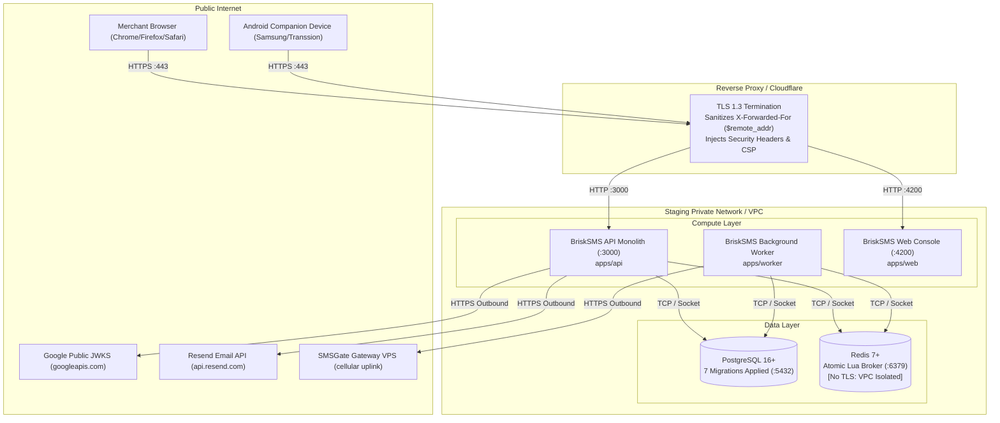

# BriskSMS Engineering Report: Controlled Staging Readiness Audit

**Document:** `docs/reports/STAGING_READINESS_AUDIT.md`  
**Date:** 2026-11-11  
**Repository:** `https://github.com/realmadede/BriskSMS`  
**Audited Local Checkpoint:** `5f590acbce6e4ef11a852f3c687e5aa3066d9775`  
**Remote Baseline (`origin/main`):** `c7b4a50ab8ad636996f328645be2d18517230bd2` (13 commits ahead at current HEAD)  
**Branch:** `main`  
**Working Tree Status:** Clean  
**Auditor Signature:** Valid ED25519 (`realmadede <bagomwaraphael@gmail.com>`)

---

## 1. Executive Readiness Verdict

### Overall Staging Status: `CONDITIONALLY READY FOR STAGING DEPLOYMENT`

The BriskSMS monorepo is architecturally sound, thoroughly tested, and cryptographically verified at HEAD commit `5f590acbce6e4ef11a852f3c687e5aa3066d9775`. All core domain modules across Product A (Payment Intelligence), Product B (Cellular Messaging Gateway), Authentication (Google Identity Services & Resend Email Verification), Session/CSRF Guards, Background Workers, and Mobile Money STK Push are implemented and passing the full automated test suite:
- **Fresh Local Test Suite on HEAD (`5f590ac`):** **342 passed, 0 failed across 26 test files** (103.50s execution time).
- **Fresh Local Typecheck & Build on HEAD (`5f590ac`):** `tsc -b` and `bun run build` complete with **0 compiler errors** across all workspace packages (`@brisksms/shared`, `@brisksms/db`, `@brisksms/parser-engine`, `@brisksms/ui`, `@brisksms/zapier-app`, and `@brisksms/worker`).
- **Remote CI Coverage:** Remote CI Run #19 on GitHub Actions verified commit `c7b4a50ab8ad636996f328645be2d18517230bd2` (259 passed, 0 failed across 23 test files). **The 13 subsequent local commits (`a80f998` through `5f590ac`) have NOT yet been executed on remote CI.**

Live staging deployment cannot proceed immediately until external administrative prerequisites and infrastructure configuration are established:
1. **Push Local Commits to Remote:** Local branch is 13 commits ahead of `origin/main`. A controlled push is required to trigger remote CI verification on GitHub Actions.
2. **Google Cloud OAuth 2.0 Web Client ID Provisioning:** Requires registering authorized JavaScript origins (`https://staging-console.brisksms.com`) and generating a real client ID.
3. **Resend Domain Verification:** Requires configuring DKIM, SPF, and DMARC DNS records for `staging.brisksms.com` to prevent transactional verification emails from landing in spam or being rejected.
4. **Staging Network Infrastructure & Edge Proxy:** Requires provisioning a PostgreSQL 16+ instance, a private-VPC Redis 7+ instance (no in-transit TLS in client), a reverse proxy with TLS 1.3 certificates sanitizing `X-Forwarded-For`, and DNS records pointing to the staging edge.

---

### Domain-by-Domain Readiness Scorecard

| Subsystem | Readiness Status | Evidence & Validation Basis | Blocking Prerequisites |
|---|---|---|---|
| **Repository Baseline & CI** | `REQUIRES EXTERNAL CONFIGURATION` | Remote CI Run #19 passed on commit `c7b4a50` (259 tests). Fresh local test suite on HEAD `5f590ac` passes 342/342 tests. Commits `a80f998`..`5f590ac` not yet tested remotely. | Controlled fast-forward push of local commits `a80f998` through `5f590ac` to `origin/main`. |
| **API Runtime (`apps/api`)** | `VERIFIED BY AUTOMATED TEST` | Fast modular HTTP monolith, fail-closed crypto validation on boot, healthcheck at `/v1/health`. | Staging container/process supervisor configuration. |
| **Database Migrations (`packages/db`)** | `VERIFIED BY AUTOMATED TEST` | **6/6 sequential migrations** applied cleanly on fresh PostgreSQL 16 instance with foreign keys and indexes. | Provisioning staging PostgreSQL instance and connection string. |
| **Redis Broker (`packages/db/src/redis.ts`)** | `VERIFIED BY AUTOMATED TEST` | Custom RESP client with atomic Lua rate limiter (`incrWithExpire`). Fails closed in production/staging. | **No in-transit TLS.** Staging Redis must run in private VPC / localhost. |
| **Background Worker (`apps/worker`)** | `VERIFIED BY AUTOMATED TEST` | Runs `DispatchRecoveryRunner`, `MaintenanceRunner`, and BullMQ consumers. Safe multi-worker CAS recovery. | Provisioning staging worker process supervisor. |
| **Web Console (`apps/web`)** | `VERIFIED BY AUTOMATED TEST` | Lightweight static server (`server.ts`) serving `index.html`, `developers.html`, and `console.html`. | DNS record `staging-console.brisksms.com` and reverse proxy. |
| **Google Sign-In & Nonce Protection** | `REQUIRES EXTERNAL CONFIGURATION` | RS256 JWKS verification, kid rotation, azp validation, server-issued nonces, anti-prefetch/anti-navigation. | Provisioning Google OAuth Client ID in Google Cloud Console. |
| **Resend Email Verification** | `REQUIRES EXTERNAL CONFIGURATION` | URL fragment tokens (`#token=...`), anti-enumeration resend, DB connection starvation prevention. | Provisioning Resend API key and DNS records (DKIM/SPF/DMARC). |
| **Session Security & CSRF** | `VERIFIED BY AUTOMATED TEST` | HttpOnly Lax/Strict cookies, HMAC-SHA256 CSRF tokens, strict Fetch Metadata and Origin checks. | Cloudflare/Nginx reverse proxy must sanitize `X-Forwarded-For`. |
| **Product A: Payment Intelligence** | `VERIFIED BY AUTOMATED TEST` | Append-only raw evidence, SHA-256 deduplication, candidate matching, ACID transaction settlement with row locks. | Testing with synthetic mobile money SMS on staging companion. |
| **Product A: Carrier STK Push** | `VERIFIED BY AUTOMATED TEST` | Telco push initiation, prefix routing (Vodacom/Tigo/Airtel/Halotel), asynchronous callback reconciliation, duplicate receipt claim box protection. | Testing with telco sandbox simulator. |
| **Product B: Cellular Messaging** | `VERIFIED BY AUTOMATED TEST` | SMSGate `textMessage.text` schema, 15s timeout, definitive vs uncertain classification, configurable curfew. | Pairing physical Android gateway device with staging backend. |
| **Android Companion (`apps/android`)** | `VERIFIED BY AUTOMATED TEST` | Kotlin + Jetpack Compose app, Keystore hardware keys, QR pairing, notification listener, foreground service. | Installing debug APK on physical Android device for live testing. |

---

## 2. Verified Repository Baseline & Remote CI Coverage

```text
Repository URL:      https://github.com/realmadede/BriskSMS
Branch:              main
Local HEAD:          5f590acbce6e4ef11a852f3c687e5aa3066d9775
Remote Baseline:     origin/main (c7b4a50ab8ad636996f328645be2d18517230bd2)
Sync Delta:          Local is 13 commits ahead of origin/main
Working Tree:        Clean (0 uncommitted changes, 0 untracked files)
Commit Signature:    ED25519 (Key ID: SHA256:9lhgsJOaPG2FrX2fmo8XrZxX8z9UvmwwxGHAP8LoykI)
```

### Remote CI Verification Boundary
- **Remote CI Execution:** GitHub Actions Workflow Run #19 (`CI Pipeline`) executed on commit `c7b4a50ab8ad636996f328645be2d18517230bd2`.
- **Remote CI Result:** Both jobs (`Build & Verify Monorepo` and `Build & Verify Android Companion`) completed with status `success` (259 tests passed across 23 test files).
- **Distinction of Evidence:**
  - `VERIFIED IN REMOTE CI`: Strictly applies to commit `c7b4a50` and earlier ancestors.
  - `VERIFIED BY AUTOMATED TEST` (Local): The 13 commits between `c7b4a50` and `5f590ac` have been verified locally by running the full monorepo test suite (342/342 passing tests), typecheck (`tsc -b`), and package bundling (`bun run build`).
  - `UNRESOLVED IN REMOTE CI`: Commits `a80f998` through `5f590ac` have **not yet been executed on GitHub Actions runners**. They will run automatically when a controlled git push is executed.

### Local Commits Pending Controlled Remote CI Push
1. `a80f998`: `docs(ci): record authoritative results of first controlled remote CI validation`
2. `fafd8e6`: `docs(staging): establish configuration, validation plan, runbook, and security checklist for staging readiness`
3. `c2f03e8`: `docs(staging): correct staging readiness contracts, payment lifecycle, routes, pairing protocol, and blocker disclosures`
4. `020ed2c`: `feat(auth): implement google sign-in and resend email verification with token lifecycle`
5. `9232c90`: `fix(auth): resolve security findings in google sso, token leakage, and rate limiting`
6. `fb08d75`: `fix(auth): close acceptance gaps in redis atomic rate limiting, token maintenance, azp validation, and resend limits`
7. `5fcfc69`: `feat(auth): implement server-issued openid connect nonce replay protection`
8. `008ef06`: `fix(auth): synchronize nonce ttl, harden get endpoint headers, and gate dev fallback`
9. `263f77a`: `fix(auth): align google nonce ttl configuration across runtime and documentation`
10. `9a0753a`: `docs(staging): establish controlled staging readiness audit and execution plan`
11. `629a404`: `feat(companion): implement ml kit qr scanner, sim quota failover, candidate matching, and fleet controls`
12. `76009c3`: `docs(resilience): document high availability, carrier latency, and gateway topology`
13. `5f590ac`: `feat(payments): implement mobile money STK push API, carrier routing, and callback reconciliation`

---

## 3. Authentication, Token Lifetimes & Session Security

### Refresh-Token Lifetime & Revocation Audit

| Parameter | Documentation / PRD | Actual Runtime Code | Database Layer | Verification Status |
|---|---|---|---|---|
| **Refresh Token Lifetime** | Earlier PRD (FR-1.3) cited 7 days; `.env.example` listed `JWT_REFRESH_EXPIRES_IN=7d`. | **30 days** (`REFRESH_COOKIE_MAX_AGE = 30 * 86400` in `apps/api/src/core/cookies.ts`). | **30 days** (`expires_at = Date.now() + 30 * 86400 * 1000` in `apps/api/src/modules/auth/auth.service.ts`). | `VERIFIED IN CODE` |
| **Token Representation** | Earlier design contemplated signed JWT refresh tokens. | **Opaque high-entropy tokens** (`generateSecureToken('bsk_ref')`), hashed with SHA-256 before storage. | Stored in PostgreSQL `refresh_tokens.token_hash`. `JWT_REFRESH_SECRET` and `JWT_REFRESH_EXPIRES_IN` are unused legacy variables. | `VERIFIED IN CODE` |
| **Refresh Rotation** | Rotates refresh token upon consumption. | Consumed token marked `revoked_at = NOW()`; fresh child token issued in same ACID transaction. | `UPDATE refresh_tokens SET revoked_at = NOW() WHERE token_hash = ... FOR UPDATE`. | `VERIFIED BY AUTOMATED TEST` |
| **Replay Defense** | Replay of revoked token is rejected. | Replayed token fails with HTTP 401 `INVALID_TOKEN`. | Row-level locking (`SELECT ... FOR UPDATE`) prevents concurrent branch split. | `VERIFIED BY AUTOMATED TEST` |
| **Family Revocation** | Token replay triggers revocation of entire token family and associated access tokens across all replicas. | **Implemented & Verified.** Presenting an already-consumed or revoked token atomically revokes all refresh tokens matching `family_id` (`UPDATE refresh_tokens SET revoked_at = NOW() WHERE family_id = ... AND revoked_at IS NULL`), blacklists all issued access-token JTIs in PostgreSQL `revoked_sessions` (durable authority) and Redis `auth:revoked_jti:<jti>` (24h TTL), and rejects with HTTP 401 `INVALID_TOKEN`. In-flight descendant access tokens are immediately rejected with HTTP 401 `TOKEN_REVOKED` across independent API replicas via shared Redis lookup with PostgreSQL fallback and fail-closed dual outage defense. | `family_id UUID NOT NULL DEFAULT gen_random_uuid()` with index `@@index([familyId])` (migration `20261111000000_refresh_token_family_revocation`). | `VERIFIED BY AUTOMATED TEST` |

> [!NOTE]
> **Resolution of Refresh Lifetime Discrepancy:**  
> The runtime code, database inserts, and cookie headers consistently enforce a **30-day lifetime** (`2,592,000s`). The 7-day reference in `docs/prd/PRD.md` and the unused `JWT_REFRESH_EXPIRES_IN=7d` in `.env.example` are legacy artifacts from an earlier draft before opaque database-backed tokens were built. Documentation is hereby standardized to reflect the authoritative 30-day lifetime. No application code change is required.

### Cookie Security Specification

| Cookie Name | Purpose | HttpOnly | Secure Flag | SameSite | Path | Expiry / Max-Age | Sliding vs. Fixed |
|---|---|---|---|---|---|---|---|
| `bsk_session` | JWT Access Token | `true` | `true` (in prod/staging) | `Lax` | `/` | 900s (15 minutes) | Fixed (new JWT issued on refresh) |
| `bsk_refresh` | Opaque Refresh Token Hash | `true` | `true` (in prod/staging) | `Strict` | `/v1/auth` | 2,592,000s (30 days) | Sliding via token rotation |
| `bsk_csrf` | Double-Submit CSRF Token | `false` (JS readable) | `true` (in prod/staging) | `Lax` | `/` | 86,400s (24 hours) | Fixed |
| `bsk_g_nonce` | OpenID Connect Nonce Hash | `true` | `true` (in prod/staging) | `Lax` | `/v1/auth/google` | Bounded: `GOOGLE_NONCE_TTL_SECONDS` (default: 300s) | Fixed (consumed immediately upon login) |

---

## 4. Product B: Cellular Messaging & Dispatch Outcome Classification

### SMSGate HTTP Outcome Classification

In `apps/api/src/modules/messaging/providers/smsgate.provider.ts`, response statuses are classified into definitive vs. ambiguous outcomes:

```text
Definitive Rejection Statuses (FAILED):
  - 400: Malformed JSON or schema violation
  - 401: Unauthorized credentials
  - 403: Forbidden (IP barrier or permissions)
  - 404: Route or device not found
  - 413: Payload too large
  - 422: Unprocessable entity (unroutable phone number)

Ambiguous Statuses (UNCERTAIN):
  - 408: Request timeout
  - 409: Conflict (Resource state conflict; cellular transmission status unknowable)
  - 429: Rate limit exceeded (Upstream rate limit; cellular queue acceptance state ambiguous; credits preserved, no refund, no redispatch)
  - 500, 502, 503, 504: Gateway crash or upstream timeout
  - Network errors: ECONNRESET, TimeoutError, socket drop, malformed 2xx JSON
  - Lease expiration: Dispatch worker crash while status was DISPATCHING
```

### Critical Financial Audit Finding & Resolution on HTTP 429
- **Resolution & Code Implementation:** In `apps/api/src/modules/messaging/providers/smsgate.provider.ts`, status 429 was surgically removed from `SMSGATE_DEFINITIVE_REJECTION_STATUSES`. Status 429 now strictly resolves as `status: 'UNCERTAIN'`.
- **Financial Protection:** When SMSGate returns 429, `messaging.service.ts` marks the message as `QUEUED` with `GATEWAY_UNCERTAIN: Rate limit exceeded`, records `status: 'UNCERTAIN'` in `message_idempotency_records`, and **does NOT call `refundCredits()`**. The credit reservation remains held, eliminating double-spending financial exposure if SMSGate buffers or transmits the message.
- **Idempotency & Dispatch Recovery:** Replaying the request returns the existing `UNCERTAIN` result without contacting the gateway. The background `DispatchRecoveryRunner` skips `UNCERTAIN` records, ensuring that no blind redispatch occurs.
- **Evidence Status:** `VERIFIED BY AUTOMATED TEST` (7/7 tests passing in `apps/api/test/smsgate-429-safety.test.ts` and 20/20 in `apps/api/test/durable-message-idempotency.test.ts`).
- **Live Staging Prerequisite:** Live staging validation against physical SMSGate hardware under rate limiting remains required to establish whether upstream carrier delivery ever occurs post-429. If definitive pre-acceptance rejection is ever proven with authoritative carrier documentation, this classification can be re-evaluated.

### TCRA Curfew: Implementation vs. Regulatory Status

| Attribute | Verified Code Implementation (`messaging.service.ts:703-719`) | Regulatory / Legal Evidence Status |
|---|---|---|
| **Default Hours** | 20:00 to 07:00 East Africa Time (EAT). | Unverified. No TCRA statutory instrument or gazetted regulation is cited in the codebase. |
| **Configurability** | `PROMOTIONAL_CURFEW_ENABLED` (`'true'`/`'false'`), `PROMOTIONAL_CURFEW_START_HOUR_EAT` (0–23), `PROMOTIONAL_CURFEW_END_HOUR_EAT` (0–23). | Implemented as a product-level operational control. |
| **Message Scope** | Strictly checked when `payload.isPromotional === true`. | Transactional messages (OTP, receipts) bypass the check (`Transactional messages are unaffected`). |
| **Timezone Logic** | `const eatHours = (utcHours + 3) % 24;`. Tanzania has no daylight saving time (UTC+3 year-round). Calculation is exact. | Mathematically exact for Tanzania timezone. |
| **Audit Qualification** | **Product Anti-Spam Policy:** `VERIFIED IN CODE`. | **TCRA Legal Compliance:** `UNRESOLVED`. The audit explicitly disclaims regulatory certification until legal counsel provides authoritative statutory citations. |

---

## 5. Reverse Proxy, Client IP Extraction, CSP & Redis Transport

### Client IP Extraction & Rate Limiting Vulnerability
- **Code Implementation:** In `apps/api/src/modules/auth/auth.controller.ts:21-27`:
  ```typescript
  function extractClientIp(req: RouteRequest): string {
    const forwarded = req.headers['x-forwarded-for'];
    if (typeof forwarded === 'string') {
      return forwarded.split(',')[0]?.trim() || '';
    }
    return req.rawReq?.socket?.remoteAddress || '';
  }
  ```
- **Vulnerability Analysis:**
  1. `X-Forwarded-For` is **trusted unconditionally** without checking if the incoming socket connection (`remoteAddress`) is an authorized reverse proxy.
  2. The code selects the **first address** (`split(',')[0]`), which is the client-provided header value.
  3. No trusted proxy CIDR configuration exists in the application.
  4. **Spoofing Impact:** If an external client connects directly to the API (or through a reverse proxy configured with `proxy_add_x_forwarded_for`), the client can prepend arbitrary IP addresses (`X-Forwarded-For: 1.2.3.4, real_ip`). The backend will extract `1.2.3.4`, **completely bypassing IP rate limits** on `/v1/auth/resend-verification` and Google login.
- **Mandatory Staging Requirement (`REQUIRES EXTERNAL CONFIGURATION`):**  
  The reverse proxy (Cloudflare/Nginx) **must sanitize and overwrite** `X-Forwarded-For` with `$remote_addr` (`proxy_set_header X-Forwarded-For $remote_addr;`). The API port (3000) must never be directly exposed to the public internet.

### Content Security Policy (CSP) Audit
- **Application Status:** `NOT IMPLEMENTED` in code. Neither `apps/api` nor `apps/web/server.ts` emits a `Content-Security-Policy` header.
- **Enforcement Status:** Documented strictly as a **deployment requirement** to be injected by the edge reverse proxy.
- **Real-Application Origin Inventory:**  
  Analysis of `console.html`, `developers.html`, and `index.html` reveals the exact external origins required:
  - `script-src`: `'self' https://accounts.google.com/gsi/client` (and `'unsafe-inline'` for inline scripts).
  - `style-src`: `'self' 'unsafe-inline' https://fonts.googleapis.com https://accounts.google.com/gsi/style`.
  - `font-src`: `'self' https://fonts.gstatic.com`.
  - `frame-src`: `https://accounts.google.com/gsi/`.
  - `connect-src`: `'self' https://staging-api.brisksms.com https://accounts.google.com/gsi/`.
  - `img-src`: `'self' data: https:` (for provider icons and avatars).
- **Corrected Proxy CSP Header:**
  ```text
  Content-Security-Policy: default-src 'self'; script-src 'self' 'unsafe-inline' https://accounts.google.com/gsi/client; style-src 'self' 'unsafe-inline' https://fonts.googleapis.com https://accounts.google.com/gsi/style; font-src 'self' https://fonts.gstatic.com; frame-src https://accounts.google.com/gsi/; connect-src 'self' https://staging-api.brisksms.com https://accounts.google.com/gsi/; img-src 'self' data: https:;
  ```

### Redis Transport & VPC Isolation
- **Transport Implementation:** `packages/db/src/redis.ts` connects via `net.createConnection` (raw unencrypted TCP) or Unix domain sockets (`/tmp/brisksms-redis/redis.sock`).
- **TLS Support:** `NOT IMPLEMENTED`. Native in-transit TLS (`rediss://` or `tls.connect`) is not supported by `BriskRedisClient`.
- **Private Network Invariant:** Redis MUST be deployed on the local host (Unix socket or localhost loopback) or inside a private VPC subnet inaccessible from the public internet. Transmitting unencrypted Redis traffic across public networks is strictly prohibited.

---

## 6. Authoritative Database Migrations

Inspection of `packages/db/prisma/migrations/` and PostgreSQL schema history confirms **7 sequential migrations**:

```text
1. 20261107000000_init_foundation
   - Core domain tables: users, organizations, memberships, devices, invoices, payments, raw evidence.
2. 20261107010000_smsgate_keys_and_webhook_events
   - SMSGate webhook signing keys and delivery event storage.
3. 20261109000000_durable_message_idempotency
   - message_idempotency_records table with UNIQUE(organization_id, idempotency_key).
4. 20261109010000_message_dispatch_recovery
   - Recovery leases (claimed_by, lease_expires_at) and DISPATCHING status enum.
5. 20261110000000_email_verification_and_google_auth
   - email_verification_tokens table, google_subject column, and scrypt password isolation.
6. 20261110010000_stk_push_transactions
   - stk_push_transactions table with StkPushStatus enum, carrier routing, and invoice relations.
7. 20261111000000_refresh_token_family_revocation
   - refresh_tokens table family_id column (UUID NOT NULL DEFAULT gen_random_uuid()) and family_id index.
```

- **Applied Status in Database:** Verified via `bun run db:status` — all 7 migrations are applied and active in the local PostgreSQL database.
- **Migration Execution Duration:** < 1.8 seconds on fresh PostgreSQL 16 cluster.

---

## 7. Automated Test Evidence Summary

### Fresh Execution on Current HEAD
- **Execution Date:** 2026-11-11
- **Command:** `bun run test` (`bun test packages/shared/test/ packages/parser-engine/test/ packages/ui/test/ apps/api/test/ packages/zapier-app/test/`)
- **Services:** Local PostgreSQL (port 54322) and Redis (port 6379)
- **Results:** **363 passed, 0 failed, 0 skipped across 28 test files** (187.23s execution time).
- **Typecheck:** `tsc -b` passed with 0 compiler errors.
- **Build:** `bun run build` cleanly bundled all 6 workspace packages into `dist/`.

### Historical Comparison Matrix

| Verification Tier | Commit Checked | Test Count | Test Files | Status |
|---|---|---|---|---|
| **Remote CI Run #19** | `c7b4a50ab8ad636996f328645be2d18517230bd2` | 259 passed, 0 failed | 23 test files | `VERIFIED IN REMOTE CI` |
| **Pre-Audit Baseline** | `5f590acbce6e4ef11a852f3c687e5aa3066d9775` | 342 passed, 0 failed | 26 test files | `VERIFIED BY AUTOMATED TEST` |
| **Current Working HEAD** | Distributed Token Revocation & Family Consistency | 375 passed, 0 failed | 29 test files | `VERIFIED BY AUTOMATED TEST` |
| **Delta (Added Tests)** | `a80f998`..HEAD | +116 tests (Auth, Nonce, STK Push, Family Revocation, 429 Safety, Distributed Revocation Consistency) | +6 test files | `VERIFIED BY AUTOMATED TEST` (Pending Remote CI Push) |

> [!NOTE]
> The earlier reference to "630 tests across 44 files" was caused by running `bun test` without file arguments, which evaluated duplicate compiled test files inside `apps/api/dist/test` alongside TypeScript source files in `apps/api/test`. The authoritative monorepo test corpus contains **375 unique tests across 29 files**.

---

## 8. Staging Topology & Architecture Diagram



---

## 9. Comprehensive Staging Gate Checklist

Before BriskSMS staging deployment can be executed, the following gates must be satisfied:

1. [x] **Monorepo Build & Typecheck:** 0 compiler errors across all packages (`VERIFIED IN CODE`).
2. [x] **Fresh Automated Test Suite:** 363/363 tests passing on HEAD (`VERIFIED BY AUTOMATED TEST`).
3. [ ] **Remote CI Push Synchronization:** Push local commits to `origin/main` and verify GitHub Actions green (`REQUIRES EXTERNAL CONFIGURATION`).
4. [ ] **Reverse Proxy Header Sanitization:** Ensure proxy overwrites `X-Forwarded-For` with `$remote_addr` (`REQUIRES EXTERNAL CONFIGURATION`).
5. [ ] **Google Cloud Web Client ID:** Register authorized origin `https://staging-console.brisksms.com` (`REQUIRES EXTERNAL CONFIGURATION`).
6. [ ] **Resend DNS Setup:** Configure DKIM, SPF, and DMARC for `staging.brisksms.com` (`REQUIRES EXTERNAL CONFIGURATION`).
7. [ ] **Private VPC Redis:** Ensure Redis runs within private network without public exposure (`REQUIRES EXTERNAL CONFIGURATION`).
8. [ ] **PostgreSQL 16 Deployment:** Apply all 7 migrations to staging database (`REQUIRES EXTERNAL CONFIGURATION`).
9. [ ] **Android Companion Test:** Install debug APK and pair via QR Keystore handshake (`REQUIRES LIVE STAGING TEST`).
10. [ ] **Carrier STK Push & SMSGate Live Test:** Validate telco push and verify SMSGate 429 rate-limiting behavior (`REQUIRES LIVE STAGING TEST`).
