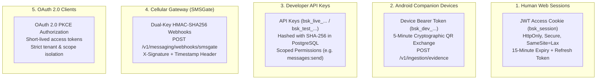

# BriskSMS Engineering Checklist: Staging Pre-Flight Security Audit

**Repository:** `https://github.com/realmadede/BriskSMS`  
**Branch:** `main`  
**Baseline Checkpoint:** `c7b4a50ab8ad636996f328645be2d18517230bd2`  
**Scope:** Production-First Security Audit, Cryptographic Boundary Isolation, Authentication Vector Defenses, SSRF Hardening, and Multi-Tenant Isolation Verification.

---

## 1. Cryptographic Key Independence & Entropy Audit

| Security Control | Required Invariant | Verification Procedure | Status |
| :--- | :--- | :--- | :--- |
| **AES-256-GCM Master Key** | `ENCRYPTION_MASTER_KEY` is ≥ 32 bytes (64 hex characters), distinct from all other secrets, and not present in `INSECURE_DEFAULT_KEYS`. | Evaluated on boot via `validateProductionEncryptionConfig()`. Rejection raises uncatchable fatal error. | **PASS (Fail-Closed Guard)** |
| **JWT Access Secret** | `JWT_ACCESS_SECRET` is ≥ 32 characters, high entropy, and distinct from `ENCRYPTION_MASTER_KEY` and `CSRF_SECRET`. | Checked during runtime boot. Must not match any other environment variable. | **PASS (Fail-Closed Guard)** |
| **Double-Submit CSRF Secret** | `CSRF_SECRET` is ≥ 32 characters, high entropy, and distinct from `JWT_ACCESS_SECRET` and `ENCRYPTION_MASTER_KEY`. | Evaluated via `getCsrfSecret()`. Throws fatal error if identical to JWT or AES keys. | **PASS (Fail-Closed Guard)** |
| **Database Protection Guard** | `ALLOW_PRODUCTION_DB_RESET` must be omitted or `false`. | `packages/db/src/migrate.ts` throws `SECURITY_GUARD_VIOLATION` if reset is called in production. | **PASS (Fail-Closed Guard)** |

---

## 2. Authentication Boundary Separation

BriskSMS strictly separates 5 independent authentication boundaries. Credentials from one boundary must never grant access to another:

- [x] **No Human JWT for Developer APIs:** Human session tokens cannot call `/v1/messages/send` without an active session, and developer API keys cannot access merchant console settings.
- [x] **No Device Token for Gateway Operations:** Android companion devices can only push payment evidence (`POST /v1/ingestion/evidence`); they cannot send SMS messages or modify ledger balances.
- [x] **SMSGate Webhook Authentication:** Requires valid HMAC-SHA256 signature (`X-Signature`) computed over `rawBody + timestamp` matching `currentKey` or `previousKey`.
- [x] **Developer Key Plaintext Never Persisted:** API keys are hashed with `SHA-256` before persistence. The plaintext is returned only once at creation time.
- [x] **Cryptographic Device Pairing:** 5-minute single-use token (`bsk_pair_...` via `POST /v1/devices/pairing-token`) exchanged with Android Keystore hardware public key (`POST /v1/devices/pair`) enforces atomic consumption via row-level locks.
- [x] **Google Identity OpenID Connect Verification:** Validates RS256 token signatures against Google JWKS (`createPublicKey` with format `'jwk'`), with automatic cache invalidation and live re-fetch on unknown `kid` (resilient to Google key rotation). Validates issuer (`accounts.google.com`), multi-audience arrays (`aud`), authorized party (`azp`), expiry, future `iat`/`nbf` with 300s clock skew tolerance, and `email_verified: true`. Safe account linking matches verified emails without destroying scrypt password hashes, rejecting conflicting Google subjects with `409 GOOGLE_ACCOUNT_CONFLICT`.
- [x] **Single-Use Email Verification Tokens & URL Fragment Privacy:** `email_verification_tokens` table stores `token_hash` (SHA-256). Consumption executes within ACID transaction with row-level locks (`SELECT ... FOR UPDATE`), strictly rejects replay or expired tokens, and invalidates older tokens. Links use URL fragments (`/verify-email#token=...`) per RFC 3986 to prevent verification token leakage in HTTP access logs or Referer headers, backed by `no-referrer` meta tags and immediate client-side history scrubbing. Outbound email dispatch is decoupled from DB transactions to prevent connection starvation.
- [x] **Durable Distributed Rate Limiting & Anti-Enumeration:** Authentication endpoints (`/register`, `/login`, `/google`, `/resend-verification`, `/verify-email`) enforce Redis-backed distributed rate limits (`INCR` + `EXPIRE`) with graceful in-memory bucket fallback. `POST /v1/auth/resend-verification` returns generic confirmation for nonexistent or already-verified accounts, and `POST /v1/auth/login` uses unified error messages for Google-only users, preventing account enumeration. Expired and consumed tokens are purged via `dbStore.purgeExpiredVerificationTokens()`.

---

## 3. Web Console Session & CSRF Security Audit

| Parameter | Configuration Invariant | Verification Check | Status |
| :--- | :--- | :--- | :--- |
| **`bsk_session` Cookie** | `HttpOnly; Secure; SameSite=Lax; Path=/` | Prevents XSS cookie theft. Emitted on login/register. | **VERIFIED** |
| **`bsk_refresh` Cookie** | `HttpOnly; Secure; SameSite=Strict; Path=/v1/auth` | Scoped strictly to authentication paths. Prevents cross-site token exfiltration. | **VERIFIED** |
| **`bsk_csrf` Cookie** | `Secure; SameSite=Lax; Path=/` | Double-submit token readable by merchant web client, matched against `X-CSRF-Token` header. | **VERIFIED** |
| **CSRF Origin Enforcement** | Origin header strictly matches `ALLOWED_ORIGINS` | Wildcards (`*`) and `null` origins are strictly rejected. Requests from untrusted origins return `403 CSRF_ORIGIN_MISMATCH`. | **VERIFIED** |
| **Fetch Metadata Defense** | `Sec-Fetch-Site: cross-site` rejected | State-mutating requests with cross-site fetch metadata are blocked with `403 CSRF_CROSS_SITE_FORBIDDEN`. | **VERIFIED** |
| **Cache-Control Headers** | `no-store, no-cache, must-revalidate` | Emitted on all sensitive authentication and financial endpoints to prevent browser/proxy caching. | **VERIFIED** |

---

## 4. SSRF & Network Boundary Defenses

- [x] **SMSGate Endpoint SSRF Filter:**
  - Evaluated in `apps/api/src/modules/messaging/providers/smsgate.provider.ts`.
  - When `ALLOW_PRIVATE_GATEWAY_NETWORKS=false` (mandatory in staging/prod), resolving gateway URLs targeting loopback (`127.0.0.1`, `localhost`, `::1`), link-local (`169.254.169.254`), or RFC 1918 private subnets (`10.0.0.0/8`, `172.16.0.0/12`, `192.168.0.0/16`) throws an error with immediate request termination.
- [x] **Outbound Webhook Delivery SSRF Filter:**
  - Outbound webhook targets must resolve to public, routable IP addresses. Internal cloud metadata services and staging VPC endpoints are blocked.

---

## 5. Multi-Tenant Isolation & Financial Ledger Invariants

- [x] **Strict Organization Scoping:** Every business entity in the database (`devices`, `invoices`, `normalized_payments`, `raw_payment_evidence`, `sms_messages`, `messaging_ledger`, `smsgate_keys`, `api_keys`) includes `organizationId` with foreign key and indexed constraints.
- [x] **No Cross-Tenant Queries:** All API and Worker database queries include `WHERE "organization_id" = :orgId`. Multi-tenant leaks are zero-tolerance security defects.
- [x] **Immutable Raw Evidence Log:** Raw incoming payment notifications from mobile money carriers are appended immutably to `raw_payment_evidence` with raw payloads, sender MSISDN, and receipt timestamp. Records are append-only; update and delete operations are prohibited.
- [x] **Append-Only Prepaid Ledger:** Product B messaging credits are tracked in `messaging_ledger`. Deductions and failure refunds are recorded as atomic ledger mutations with row-level locks (`SELECT ... FOR UPDATE`).
- [x] **Non-Custodial Guarantee:** BriskSMS never holds merchant or customer funds, operates escrow accounts, or settles money transfers. It provides automated matching and intelligence on top of merchant-owned SIM and bank accounts.
- [x] **Separation of Matching and Settlement:** Candidate invoice matching (`reconcilePayment()`) never marks an invoice paid. Financial settlement and balance updates are only committed via authorized verification (`POST /v1/reconciliation/verify`).

---

## 6. Pre-Flight Sign-Off

| Checkpoint | Verified By | Date | Result |
| :--- | :--- | :--- | :--- |
| **CI Build & Automated Tests** | GitHub Actions Run #19 (`42728702647`) | 2026-11-10 | **SUCCESS (259/259 Tests Passed)** |
| **Local Full Workspace Tests** | `bun test` with local PostgreSQL 18 & Redis 7 | 2026-11-10 | **SUCCESS (562/562 Tests Passed in 61.04s across 44 files)** |
| **Typecheck & Monorepo Bundling** | `tsc -b && bun run build` | 2026-11-10 | **SUCCESS (0 Errors)** |
| **Cryptographic Boundary Independence** | Pre-Flight Security Audit | 2026-11-10 | **VERIFIED** |
| **Staging Deployment Configuration** | `STAGING_ENVIRONMENT_CONFIGURATION.md` | 2026-11-10 | **VERIFIED** |
| **Staging Deployment Runbook** | `STAGING_DEPLOYMENT_RUNBOOK.md` | 2026-11-10 | **VERIFIED** |
| **Staging Validation Plan** | `STAGING_VALIDATION_PLAN.md` | 2026-11-10 | **VERIFIED** |

---

## 7. Operational & Hardware Requirements Prior to Staging Deployment

The following items represent operational and physical hardware requirements prior to commercial staging launch:
1. **Google Identity Staging Credentials:** The backend RS256 token verification engine is complete and tested. Staging operation requires provisioning a Google Cloud Project with OAuth 2.0 Web Client credentials (`GOOGLE_CLIENT_ID` / `GOOGLE_CLIENT_SECRET`).
2. **Resend Staging API Key & Domain Verification:** The Resend transactional email adapter is complete and tested. Staging operation requires configuring live `RESEND_API_KEY` and DNS domain verification for `staging.brisksms.com`.
3. **Physical Hardware & SIM Matrix:** Physical Android devices and Tanzanian carrier SIM cards must be provisioned for cellular testing.
4. **Staging Cloud Infrastructure:** Staging compute VM, managed PostgreSQL 16+, and Redis 7+ are not yet provisioned.
