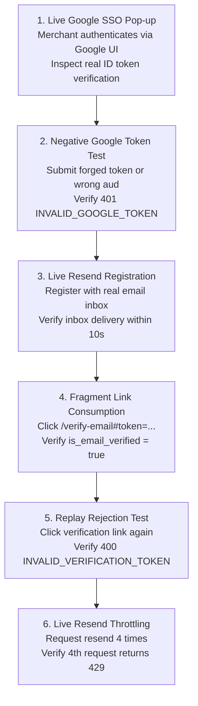

# BriskSMS Engineering Plan: Staging Validation & Integration Strategy

**Repository:** `https://github.com/realmadede/BriskSMS`  
**Branch:** `main`  
**Baseline Checkpoint:** `c7b4a50ab8ad636996f328645be2d18517230bd2`  
**Status:** **Proposed Execution Plan (Pending staging infrastructure provisioning, physical hardware deployment, and resolution of authentication blockers)**  
**Target Environment:** Isolated Staging Environment (Cloud Modular Monolith + Physical Android Test Devices + Tanzanian SIM Matrix)  
**Scope:** Multi-Service Topology, Workstream Test Matrices, Strict Financial Payment Lifecycle, Durable Idempotency & Lease Recovery, Cellular SIM Routing, Web Console Session Security, Developer Extensibility, and Operational Rollback Runbooks.

> [!IMPORTANT]
> **Staging Validation Status:** Staging is **NOT** labeled as validated prior to actual deployment and live test execution on staging infrastructure. This document defines the protocol, test matrix, and verification gates that will be executed once staging infrastructure and physical test hardware are provisioned.

---

## 1. Executive Summary & Objectives

The purpose of this staging validation plan is to transition BriskSMS from isolated unit and continuous integration testing into an end-to-end operational staging environment. 

In this environment, real mobile money payment notifications, cellular SMS gateways, background queue consumers, web consoles, and developer APIs will interact under production-like conditions without risking customer funds, commercial messaging credits, or live merchant operations.

### Core Objectives:
1. **Validate Multi-Service Orchestration:** Verify seamless coordination between the API modular monolith (`apps/api`), the asynchronous BullMQ queue worker (`apps/worker`), PostgreSQL 16+, and Redis 7+.
2. **Execute Full Workstream Testing:** Test all five commercial workstreams:
   - Workstream 1: Identity & Session Security (`apps/api`, `apps/web`)
   - Workstream 2: Product A — Payment Intelligence & Companion Ingestion (`apps/android`, `apps/api`)
   - Workstream 3: Product B — Cellular SMSGate Gateway, Durable Idempotency & Automated Lease Recovery (`apps/api`, `apps/worker`)
   - Workstream 4: Developer Platform, Scoped API Keys, OAuth 2.0 PKCE & Outbound Webhooks (`apps/api`, `packages/zapier-app`)
   - Workstream 5: Merchant Web Console Experience (`apps/web`)
3. **Verify Cellular & Hardware Boundary Integrations:** Validate physical Android companion relay, dual-SIM cellular routing across Tanzanian mobile networks, and foreground service persistence.
4. **Conduct External Security Penetration Testing:** Verify OWASP Top 10 API security compliance, cross-tenant isolation, CSRF protections, SSRF defenses, and cryptographic key boundaries.
5. **Establish Operational Runbooks:** Validate database migration recovery, emergency signing-key rotation, dispatch lease recovery, and cellular gateway failover procedures before authorizing production deployment.

---

## 2. Staging Infrastructure & Topology

The staging environment mirrors production while maintaining strict network, database, and credential isolation:

```mermaid
flowchart TD
    subgraph Public_Internet["Public Internet & Merchant Clients"]
        MerchantBrowser["Merchant Web Console (apps/web)<br/>Port: 4200 (Static Assets)"]
        DevClient["Developer API Clients / Zapier"]
        AndroidIngest["Product A: Android Payment Companion<br/>(API 26+ Physical Phone)"]
        AndroidGateway["Product B: SMSGate Cellular Gateway<br/>(Physical Multi-SIM Android Device)"]
    end

    subgraph Edge_Security["Edge & Reverse Proxy Layer (Cloudflare / Nginx Staging)"]
        Proxy["Reverse Proxy / WAF<br/>(TLS 1.3, HSTS, DDoS Protection, Origin Verification)"]
    end

    subgraph Staging_Compute["Isolated Staging Compute Cluster (Single VM or VPC Group)"]
        API["BriskSMS API Modular Monolith (apps/api)<br/>Node.js 24 / Bun<br/>Port: 3000"]
        Worker["BriskSMS Async Queue Worker (apps/worker)<br/>BullMQ Queue Consumer & DispatchRecoveryRunner<br/>Concurrency: 4"]
    end

    subgraph Staging_Persistence["Staging Data & State Tier"]
        PG[("Managed PostgreSQL 16+<br/>(Database: brisksms_staging)<br/>Row-Level Locks, ACID Transactions, sslmode=require")]
        Redis[("Managed Redis 7+<br/>(Namespace: staging:bullmq)<br/>Password Auth, Private VPC TCP Networking")]
    end

    subgraph External_Simulators["External Integration Test Sinks"]
        WebhookSink["Outbound Webhook Echo Service<br/>(e.g., ngrok / webhook.site)"]
        CarrierTower["Tanzanian Cellular Networks<br/>(Vodacom, Mixx/Tigo, Airtel, Halotel)"]
    end

    MerchantBrowser -->|HTTPS / WSS| Proxy
    DevClient -->|HTTPS Bearer/API Key| Proxy
    AndroidIngest -->|POST /v1/ingestion/evidence| Proxy
    AndroidGateway -->|POST /v1/messaging/webhooks/smsgate| Proxy

    Proxy -->|Host: staging-api.brisksms.com| API
    Proxy -->|Host: staging-console.brisksms.com| MerchantBrowser
    
    API -->|DATABASE_URL (SSL)| PG
    API -->|REDIS_URL (TCP/Auth)| Redis
    
    Worker -->|DATABASE_URL (SSL)| PG
    Worker -->|REDIS_URL (TCP/Auth)| Redis
    Worker -->|Outbound Webhooks| WebhookSink
    Worker -->|SMS Dispatch (HTTP)| AndroidGateway

    AndroidGateway -->|Cellular Radio| CarrierTower
```

---

## 3. Product A: Payment Intelligence Ingestion & Settlement Lifecycle

### 3.1 Non-Custodial Core Principle & Settlement Invariant
BriskSMS is **non-custodial**. It never holds merchant funds, operates escrow accounts, or acts as a payment clearing house. Receiving an Android payment notification is **NOT** proof of final financial settlement.

### 3.2 Authoritative 6-Step Payment Lifecycle
The actual implementation strictly separates matching from settlement across six sequential phases:

```
[ Carrier Notification ]
        │
        ▼
1. EVIDENCE INGESTION        ──▶ Persisted immutably in raw_payment_evidence (status: OBSERVED)
        │
        ▼
2. EVIDENCE NORMALIZATION    ──▶ Normalized to NormalizedPayment (OBSERVED -> NORMALIZED);
        │                        Deduplicated via hash(org_id + provider + ref + amount + timestamp)
        ▼
3. CANDIDATE MATCHING        ──▶ reconcilePayment() finds open invoice. If exact reference + amount:
        │                        sets state = MATCHED and candidate_invoice_id.
        │                        CRITICAL: Invoice status is NOT marked PAID! Remains UNPAID / PARTIALLY_PAID.
        ▼
4. INDEPENDENT VERIFICATION  ──▶ POST /v1/reconciliation/verify creates immutable PaymentVerification;
        │                        transitions NormalizedPayment to VERIFIED.
        ▼
5. AUTHORIZED SETTLEMENT     ──▶ Executes in ACID transaction with SELECT ... FOR UPDATE.
        │                        Creates InvoicePayment, updates paid_amount_cents and balance_cents.
        │                        Transitions invoice.status -> PARTIALLY_PAID, PAID, or OVERPAID.
        ▼
6. FULFILLMENT ELIGIBILITY   ──▶ Evaluates fulfillmentEligible = (status === PAID || status === OVERPAID).
                                 Emits fulfillment.eligible event only upon verified settlement.
```

### 3.3 Authoritative Prisma Invoice Enums
- `InvoiceStatus`: `UNPAID`, `PARTIALLY_PAID`, `PAID`, `OVERPAID`, `VOID`, `REFUNDED`.
- `TransactionState`: `OBSERVED`, `NORMALIZED`, `DUPLICATE_REJECTED`, `UNMATCHED`, `MATCHED`, `VERIFICATION_PENDING`, `VERIFIED`, `REJECTED`, `REVIEW_REQUIRED`, `FULFILLMENT_PENDING`, `FULFILLED`, `SETTLEMENT_SUSPENDED`.
- `VerificationMethod`: `INDEPENDENT_PROVIDER_QUERY`, `BANK_STATEMENT_RECONCILIATION`, `MANUAL_FINANCE_APPROVAL`, `MANUAL_REJECTION`.

---

## 4. Android Device Pairing Protocol

The device pairing implementation adheres to a **cryptographic, single-use, 5-minute QR pairing exchange**:

1. **Token Generation (`POST /v1/devices/pairing-token`):**
   - Requires `OWNER` or `ADMIN` authenticated session.
   - Enforces device quota based on active subscription tier.
   - Generates high-entropy token: `bsk_pair_[24 random bytes]` with `ttlSeconds: 300` (**5 minutes**).
   - Generates QR payload:
     ```json
     {
       "token": "bsk_pair_...",
       "org": "organization_uuid",
       "endpoint": "https://staging-api.brisksms.com/v1",
       "exp": "2026-11-10T04:00:00.000Z"
     }
     ```
2. **Device Hardware Key Exchange (`POST /v1/devices/pair`):**
   - Android Companion generates a hardware-backed cryptographic keypair in Android Keystore.
   - Submits payload: `{ enrollmentToken, publicKeyPem, deviceModel, manufacturer, androidVersion, appVersion, ingestionMode, label }`.
   - Backend opens PostgreSQL transaction with row-level lock (`SELECT ... FOR UPDATE` on `pairing_tokens`).
   - Verifies: token exists, `used_at IS NULL`, and `expires_at > NOW()`.
   - Generates raw device token: `bsk_dev_[32 random bytes]`, stores its `SHA-256` hash in `devices.device_token_hash`.
   - Marks token consumed: `UPDATE pairing_tokens SET used_at = NOW(), used_by_device_id = :deviceId`.
   - Returns plaintext `deviceToken` to Android companion, which stores it securely in `KeystoreSecureStorage`.

---

## 5. Physical SIM & Android Hardware Test Matrix

| Carrier / Provider | Network Code | Test Number Prefix | Supported Ingestion (Product A) | Outbound Dispatch (Product B) | Physical SIM Slot |
| :--- | :--- | :--- | :--- | :--- | :--- |
| **Vodacom Tanzania** | 640-04 | `+255 74x`, `+255 75x`, `+255 76x` | M-Pesa push/SMS notifications (`MPESA`) | SMSGate SIM 1 routing via cellular radio | Slot 1 |
| **Mixx by Yas (Tigo)** | 640-02 | `+255 65x`, `+255 67x`, `+255 71x` | Tigo Pesa payment notifications (`TIGO_PESA`) | SMSGate SIM 2 routing via cellular radio | Slot 2 |
| **Airtel Tanzania** | 640-05 | `+255 68x`, `+255 69x`, `+255 78x` | Airtel Money notifications (`AIRTEL_MONEY`) | Carrier routing / fallback | Secondary Test Device |
| **Halotel Tanzania** | 640-09 | `+255 62x` | HaloPesa notifications (`HALOPESA`) | Carrier routing / fallback | Secondary Test Device |
| **CRDB Bank** | N/A | Alpha sender `CRDB` | Bank push alerts & payment receipts | N/A (Inbound evidence only) | Notification Ingestion |

### Android Companion & Gateway Hardware Profile:
- **Product A Companion Phone:** Dedicated physical Android handset running Android 8.0+ (API 26 to API 35).
  - *Permissions Required:* `BIND_NOTIFICATION_LISTENER_SERVICE`, `POST_NOTIFICATIONS`, `REQUEST_IGNORE_BATTERY_OPTIMIZATIONS`.
  - *OEM Battery Optimization:* Whitelisted from aggressive background process termination (Samsung Auto-optimization disabled, Xiaomi MIUI battery saver set to "No restrictions", Transsion autostart enabled).
- **Product B SMSGate Gateway Device:** Dedicated physical dual-SIM Android handset running the SMSGate relay application.
  - *Network Configuration:* Direct HTTPS connectivity to `staging-api.brisksms.com`.
  - *Webhook Signing:* Configured with staging HMAC-SHA256 device signing secret.

---

## 6. Staging Test Matrix & Verification Protocols

### Workstream 1: Identity, Authentication & Web Console Session Security
| Test ID | Test Scenario | Execution Method | Expected Verifiable Result |
| :--- | :--- | :--- | :--- |
| **STG-AUTH-01** | Merchant Registration & Initial Session | `POST /v1/auth/register` | Emits `bsk_session` (HttpOnly, Secure, SameSite=Lax), `bsk_refresh` (HttpOnly, Secure, SameSite=Strict, Path=/v1/auth), and `bsk_csrf` (Secure, SameSite=Lax). User and Organization records created in DB. |
| **STG-AUTH-02** | Cross-Site Origin & Fetch Metadata Defense | `POST /v1/auth/login` from unauthorized origin | Terminated with `403 CSRF_ORIGIN_MISMATCH`. Request with `Sec-Fetch-Site: cross-site` rejected with `403 CSRF_CROSS_SITE_FORBIDDEN`. |
| **STG-AUTH-03** | HMAC-Signed Double-Submit CSRF Verification | State-mutating `POST` without `X-CSRF-Token` | Blocked with `403 CSRF_TOKEN_MISSING`. Valid matching cookie + header allowed. |
| **STG-AUTH-04** | Atomic Refresh Token Rotation & Concurrency Lock | `POST /v1/auth/refresh` using cookie | Issues new access token & rotates refresh token. Old refresh token immediately invalidated in `refresh_tokens`. Concurrent reuse blocked via `SELECT ... FOR UPDATE`. |
| **STG-AUTH-05** | Complete Logout & Session Invalidation | `POST /v1/auth/logout` | Emits `Max-Age=0` clearing cookies. Invalids JTI in `revoked_sessions` and revokes DB refresh token. Subsequent calls with old cookie return `401`. |
| **STG-AUTH-06** | Google Identity SSO Token Verification | `POST /v1/auth/google` with RS256 token | Verifies signature, audience, issuer, expiry, and email_verified claim. Auto-provisions merchant workspace or safely links existing account without password loss. Sets HttpOnly cookies. |
| **STG-AUTH-07** | Transactional Email Verification via Resend | `POST /v1/auth/register` & `POST /v1/auth/verify-email` | Dispatches single-use `bsk_ev_...` token via Resend adapter. User clicks `/verify-email#token=...`; frontend console extracts token from URL fragment (RFC 3986 log privacy) and submits to `POST /v1/auth/verify-email`; atomically consumes token with `SELECT ... FOR UPDATE` and sets `is_email_verified = true`. Replay rejected with `400`. |
| **STG-AUTH-08** | Non-Enumerating Email Verification Resend (Dual Limits) | `POST /v1/auth/resend-verification` | Throttled by IP (5 requests / 15 min) and privacy-preserving recipient hash (3 requests / 15 min). Invalidates old tokens. Returns identical generic success response for missing, unverified, already-verified, or invalid syntax accounts (anti-enumeration). |
| **STG-AUTH-09** | Conflicting Google Identity Account Protection | `POST /v1/auth/google` with matching email but conflicting Google `sub` | Rejects hijack attempt with `409 GOOGLE_ACCOUNT_CONFLICT`. Existing account credentials, Google ID, and workspace associations remain untouched. |
| **STG-AUTH-10** | Google Multi-Audience & Authorized Party (`azp`) Enforcement | `POST /v1/auth/google` with multi-audience token | Rejects array `aud` tokens when `azp` is missing or mismatched. Rejects string `aud` when `azp` conflicts with configured `GOOGLE_CLIENT_ID`. Accepts validly matched `azp`. |
| **STG-AUTH-11** | Google Identity Nonce Replay & Browser Session Binding | `POST /v1/auth/google/nonce` & `POST /v1/auth/google` | Server issues 32-byte cryptographic nonce with 300s default TTL (configurable 30–900s via `GOOGLE_NONCE_TTL_SECONDS`) and binds to HttpOnly `bsk_g_nonce` cookie. Validates `hash(token.nonce) === cookieHash`, atomically consumes nonce via Redis `DEL`, clears cookie, and rejects replayed or expired nonces with `401 INVALID_GOOGLE_NONCE`. |
| **STG-AUTH-12** | Cross-Session Nonce Replay Isolation | Authenticate Browser Session B with Token minted for Browser Session A | Rejects with `401 INVALID_GOOGLE_NONCE` ("Google ID token nonce does not match browser session nonce"). Rejects missing cookie or missing token nonce claim. |

### Workstream 2: Product A — Payment Intelligence & Companion Ingestion
| Test ID | Test Scenario | Execution Method | Expected Verifiable Result |
| :--- | :--- | :--- | :--- |
| **STG-PAY-01** | 5-Minute Cryptographic QR Pairing | `POST /v1/devices/pairing-token` & `POST /v1/devices/pair` | Issues `bsk_pair_...` (300s TTL). Companion submits Keystore `publicKeyPem`. Atomically consumes token, registers device, returns `bsk_dev_...`. Duplicate attempt fails with `401`. |
| **STG-PAY-02** | Notification Evidence Ingestion | `POST /v1/ingestion/evidence` with `bsk_dev_...` | Persists immutably in `raw_payment_evidence` (`OBSERVED`). Normalizes M-Pesa, Tigo, Airtel, Halotel, and CRDB Bank alerts. |
| **STG-PAY-03** | Cryptographic Deduplication Verification | Re-send identical notification 5 times | Exactly 1 payment record created. 4 duplicates detected via `hash(...)` and return idempotency confirmation without re-reconciling. |
| **STG-PAY-04** | Offline Evidence Queue & Synchronization | Ingest payments in airplane mode, reconnect | Room database queues evidence locally; synchronizes in FIFO order upon network restoration without data loss. |
| **STG-PAY-05** | Candidate Invoice Matching (No Auto-Settlement) | Ingest payment matching open invoice | Candidate match marked `MATCHED`. **Invoice status remains `UNPAID` / `PARTIALLY_PAID`**. Emits `payment.matched` with `verificationRequired: true`. |
| **STG-PAY-06** | Authorized Verification & Settlement | `POST /v1/reconciliation/verify` | Records immutable `PaymentVerification`. In ACID transaction with `SELECT ... FOR UPDATE`, creates `InvoicePayment`, updates balance, sets `InvoiceStatus` (`PARTIALLY_PAID`, `PAID`, `OVERPAID`), determines `fulfillmentEligible`. |
| **STG-PAY-07** | Payment Rejection | `POST /v1/reconciliation/reject` | Transitions payment to `REJECTED`. Unbinds candidate invoice. Records audit trace. |

### Workstream 3: Product B — Cellular SMSGate Gateway, Durable Idempotency & Lease Recovery
| Test ID | Test Scenario | Execution Method | Expected Verifiable Result |
| :--- | :--- | :--- | :--- |
| **STG-MSG-01** | Organization-Scoped Durable Idempotency | `POST /v1/messages/send` with `Idempotency-Key: k1` | Exactly one message operation and one credit deduction. Repeated calls with identical key return original cached response. Different organization using `k1` is isolated. |
| **STG-MSG-02** | Prepaid Messaging Credit Enforcement | Dispatch message with zero organization credit | Immediate rejection with `402 INSUFFICIENT_CREDITS`. Top-up credits via ledger updates balance atomically. |
| **STG-MSG-03** | Crash Window Recovery Sweep (`PENDING`) | Simulate API crash after DB reservation commit | Operation remains `PENDING`. `DispatchRecoveryRunner` sweeps it after `DISPATCH_PENDING_GRACE_SECONDS` (60s), claims lease via atomic CAS, and dispatches to SMSGate. Exactly 1 gateway call. |
| **STG-MSG-04** | Crash After Claim Window (`DISPATCHING`) | Simulate API crash while waiting for SMSGate | Lease expires after lease window. Recovery runner detects expired claim with unknowable outcome and marks status `UNCERTAIN`. **NO re-dispatch, NO refund.** Routed for operator review. |
| **STG-MSG-05** | Definitive Rejection vs Terminal Failure Refund | Gateway returns 400 Bad Request or 422 Invalid | Classifies as definitive failure. Credit is refunded atomically to organization ledger once. Duplicate retries/webhooks never duplicate refund. |
| **STG-MSG-06** | Gateway HTTP 409 Conflict Handling | Gateway responds with HTTP 409 Conflict | Operation classified strictly as `UNCERTAIN`. **Never blindly refunded, never re-dispatched.** Preserved in database for reconciliation audit. |
| **STG-MSG-07** | Dual-Key Gateway Webhook Verification | `POST /v1/messaging/webhooks/smsgate` | Verifies `X-Signature` HMAC-SHA256 against `currentKey` or `previousKey`. Skew > 300s rejected. Replay within 300s rejected. |
| **STG-MSG-08** | TCRA Promotional Curfew Compliance | Dispatch promotional SMS outside 07:00-20:00 EAT | Queued with `SCHEDULED` status until 07:00 EAT next morning. Transactional OTPs bypass curfew and dispatch immediately. |

### Workstream 4: Developer Platform & Extensibility
| Test ID | Test Scenario | Execution Method | Expected Verifiable Result |
| :--- | :--- | :--- | :--- |
| **STG-DEV-01** | Developer API Key Provisioning | `POST /v1/developer/api-keys` | Returns `bsk_live_...` plaintext once. Database stores only `SHA-256` hash. Keys scoped to specific permissions (`payments:read`, `messages:send`). |
| **STG-DEV-02** | Developer Rate Limiting | Fire 150 requests/min with API key | Rate limiter throttles excess requests with `429 TOO_MANY_REQUESTS` and standard `Retry-After` headers. |
| **STG-DEV-03** | OAuth 2.0 PKCE Authorization | `GET /v1/oauth/authorize` & `POST /v1/oauth/token` | Validates code challenge and verifier. Issues scoped token. Enforces tenant boundaries. |
| **STG-DEV-04** | Outbound Webhook Retries & Backoff | Target responds with 500 error | BullMQ worker retries with exponential backoff (1s, 5s, 30s, 5m). Final failure logged in `webhook_deliveries` with error trace. |

### Workstream 5: Merchant Web Console Experience
| Test ID | Test Scenario | Execution Method | Expected Verifiable Result |
| :--- | :--- | :--- | :--- |
| **STG-WEB-01** | Static Asset Serving & Security | Access `https://staging-console.brisksms.com` | `apps/web/server.ts` serves static Stitch assets (`index.html`, `console.html`, `developers.html`) with strict security headers. |
| **STG-WEB-02** | Real-Time Dashboard Analytics | Refresh console after payments / messages | Dashboard KPI cards display exact live counts for processed volume, reconciliation rate, and gateway queue health. |

---

## 7. SMSGate Gateway Endpoint & Mode Specifications

The SMSGate integration distinguishes between two modes:
1. **SMSGate Cloud Relay (`EXTERNAL_RELAY`):**
   - Base URL: `https://api.sms-gate.app/3rdparty/v1`
   - Normalized Dispatch URL: `https://api.sms-gate.app/3rdparty/v1/messages`
   - Inbound Webhook: Delivered to `POST /v1/messaging/webhooks/smsgate`
2. **Self-Hosted / Managed Gateway (`MANAGED_GATEWAY`):**
   - Base URL: `https://gateway.brisksms.com/api/3rdparty/v1` (or tenant-configured server)
   - Normalized Dispatch URL: `https://gateway.brisksms.com/api/3rdparty/v1/messages`
   - Note on URL Normalization: Native self-hosted SMSGate uses `/api/3rdparty/v1/messages`. Passing a bare `/api/v1` path will fail with HTTP 404 unless a custom reverse proxy rewrite rule explicitly maps `/api/v1` to `/api/3rdparty/v1`.

---

## 8. Explicit Staging & External Configuration Blockers

The following items represent operational and physical hardware requirements prior to commercial staging and production launch:
1. **Google Identity OAuth Credentials (Configuration Requirement):** The Google Sign-In backend implementation and RS256 token verification engine are complete and tested with automated mock-based and local cryptographic suites. Staging operation requires provisioning a Google Cloud Project with OAuth 2.0 Web Client credentials (`GOOGLE_CLIENT_ID` / `GOOGLE_CLIENT_SECRET`) and authorized JavaScript origins for `staging-console.brisksms.com`.
2. **Resend Transactional Email API Key & DNS Verification (Configuration Requirement):** The Resend transactional email provider and token lifecycle are complete and tested with automated mock-based suites. Staging operation requires acquiring a live `RESEND_API_KEY` and configuring SPF/DKIM DNS records for `staging.brisksms.com`.
3. **Physical Cellular Hardware & Carrier SIMs:** Staging cannot complete end-to-end cellular validation without physical Android devices and active Tanzanian carrier SIMs (Vodacom, Tigo, Airtel, Halotel).
4. **Staging Cloud Compute & Persistence:** Staging compute VM, managed PostgreSQL 16+, and Redis 7+ are not yet provisioned.

---

## 9. Live External Staging Execution Protocol (Post-Provisioning Sequence)

Once the external blockers above are provisioned, the following sequential verification protocol must be executed against live external services before declaring staging operational:



1. **Step 1: Live Google Sign-In Flow:**
   - Access `https://staging-console.brisksms.com` and trigger Google Sign-In.
   - Frontend requests `POST /v1/auth/google/nonce` to obtain server-issued nonce (`bsk_gn_...`) and sets HttpOnly cookie `bsk_g_nonce` (300s default TTL, configurable via `GOOGLE_NONCE_TTL_SECONDS`).
   - Frontend initializes Google Identity Services passing `nonce: serverNonce`.
   - Merchant selects Google Account; frontend receives real Google ID token and posts to `/v1/auth/google`.
   - Backend fetches live Google certs from `https://www.googleapis.com/oauth2/v3/certs`, verifies RS256 signature, validates `aud`, `azp`, and `iss`.
   - Backend matches `hash(token.nonce)` against `bsk_g_nonce` cookie, atomically consumes nonce via Redis `DEL`, and clears `bsk_g_nonce`.
   - Session cookies (`bsk_session`, `bsk_refresh`, `bsk_csrf`) are set; user enters workspace.
2. **Step 2: Negative Google Identity Token & Nonce Replay Test:**
   - Submit a forged JWT or token issued for an unauthorized client ID to `/v1/auth/google` (rejects with 401 `INVALID_GOOGLE_TOKEN`).
   - Attempt replay of previously consumed ID token/nonce to `/v1/auth/google` (rejects with 401 `INVALID_GOOGLE_NONCE`).
   - Attempt authentication without `bsk_g_nonce` cookie or with mismatched nonce claim (rejects with 401 `INVALID_GOOGLE_NONCE`).
3. **Step 3: Live Resend Registration & Delivery:**
   - Register a new merchant with a real merchant email address via `POST /v1/auth/register`.
   - Verify email delivery arrives in the merchant inbox within 10 seconds via Resend REST API.
   - Inspect email headers: verify DKIM, SPF, and DMARC alignments for `staging.brisksms.com`.
4. **Step 4: Verification Link Consumption:**
   - Click the verification button in the email targeting `${FRONTEND_URL}/verify-email#token=...`.
   - Confirm browser executes without transmitting token in query string (log privacy).
   - Verify user account status transitions to `is_email_verified = true`.
5. **Step 5: Replay Rejection Test:**
   - Click the same verification button a second time.
   - Verify web console displays an error: token already consumed (`400 INVALID_VERIFICATION_TOKEN`).
6. **Step 6: Live Resend Verification Throttling:**
   - Request resend verification 4 consecutive times within 15 minutes.
   - Verify attempts 1-3 deliver email and return generic confirmation.
   - Verify attempt 4 is throttled with HTTP 429 `TOO_MANY_REQUESTS`.

---

## 10. Conclusion

This plan provides the verified test matrices, cryptographic specifications, and financial reconciliation lifecycle necessary to govern staging execution. Live external integrations (Google OAuth servers and Resend email delivery) are fully prepared and tested against authoritative cryptographic specifications, and are awaiting external credential and infrastructure provisioning for live end-to-end execution.
